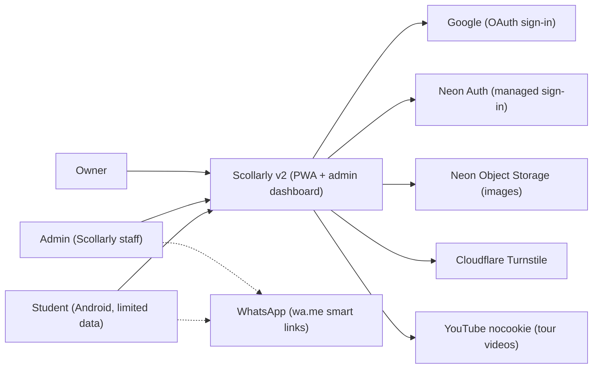
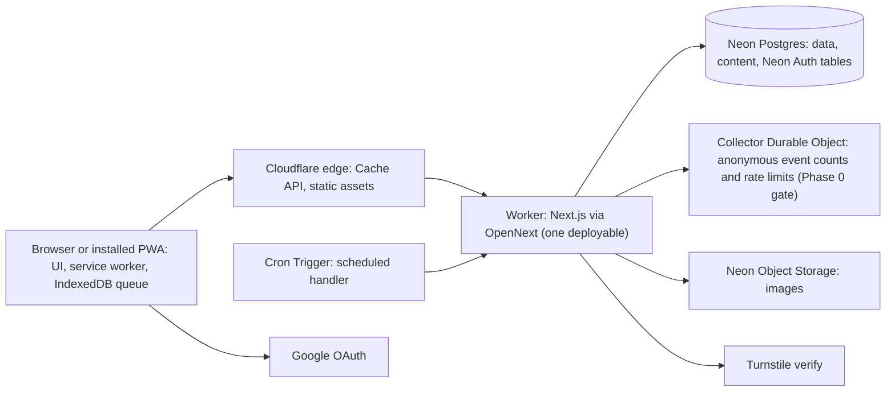
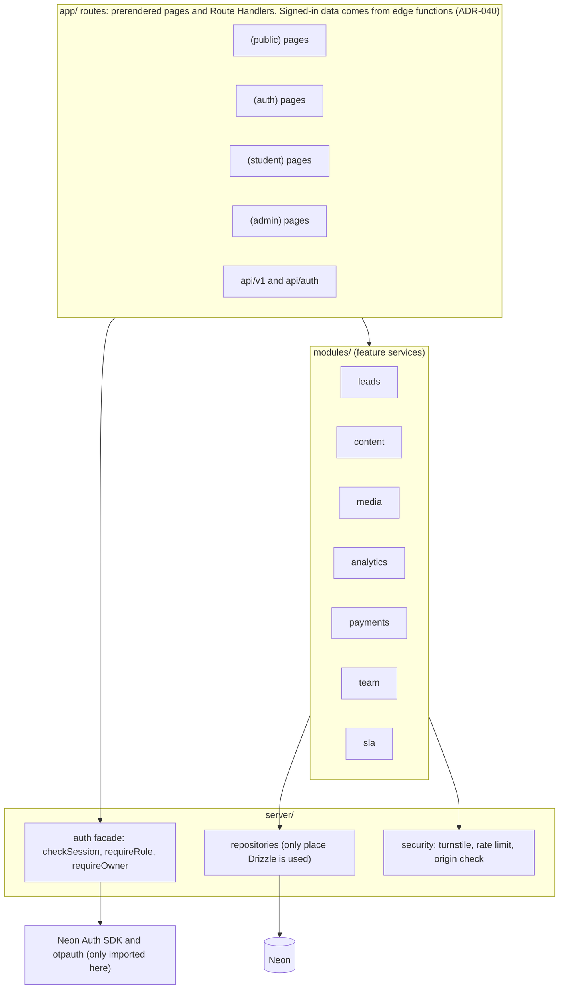
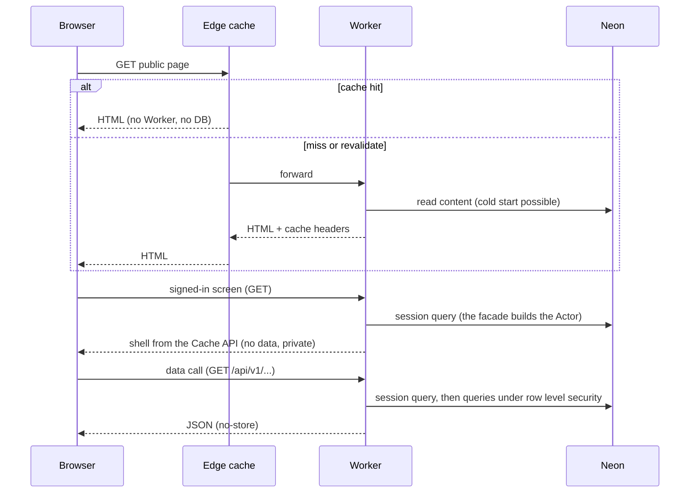
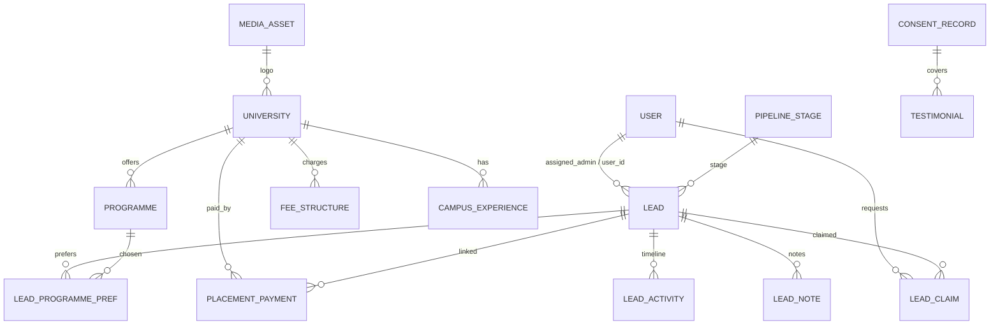
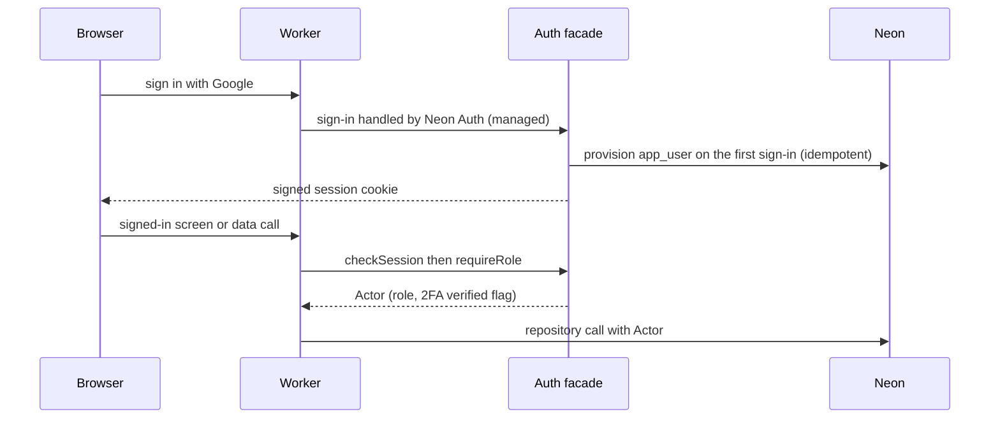
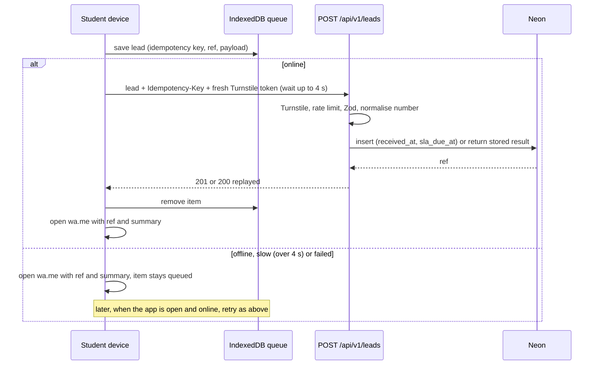
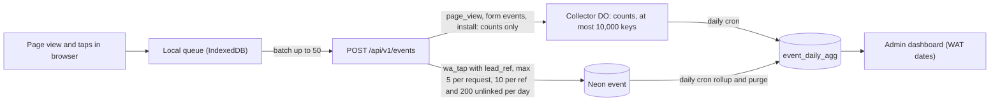
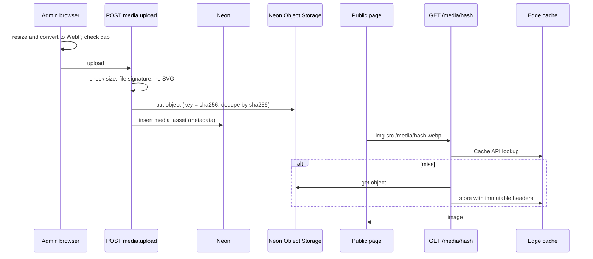

# System Architecture 2: Scollarly v2 (major refactor)

**Derived From:** PRD_2.md
**Date:** 2026-10-31
**Version 2 status (2026-10-31):** Drafted from the owner's approved design document (`docs/designs/scollarly-v2-refactor.md`) and `PRD_2.md`. It is a complete, current text: sections 1 to 20 are version 1 as built through Stage 12 (with its amendment logs), and **section 21 is new and wins wherever it disagrees with an older section**. The owner chose new versioned files for this refactor, which reverses ADR-035 for this refactor only (ADR-050). `system_architecture_1.md` is history. The version 1 status text follows.

**Changelog (version 2 against version 1):** added section 21 (hubs and four-tab navigation, account confirmation, onboarding, on-device course ordering, derived notifications, CRM dashboards, offline for signed-in screens, landing page and brand assets, CPU rows, tests, ADR-041 to ADR-050, risks, page and click map Parts A2 and B2); marked sections 11.1, 11.2, 11.4 and 16 Parts A9 to A13, B1 to B10, C3 to C7 as amended by section 21; added rows to section 2. **Downstream Impact on Essentials:** IMPACT. `system_architecture_essential_2.md` must be a single stage that builds section 21 (S13.1 to S13.9) and the Stage 10 and 11 carry-over items.

**Version 1 status (history):** Locked on 2026-10-23 by owner confirmation, then amended pre-build on 2026-10-23 by the owner's instruction after the engineering review (see the Amendment logs at the end). Nothing had been built or committed against the first text, so it was edited in place and the version stays 1. The rule that a change after the first stage starts creates a new version (and a PRD bump) was set aside by the owner on 2026-10-23 (decision D13, ADR-035): the documents are edited in place and an amendment log records every change. Amended a second time on 2026-10-23 after the Stage 0 measurements (decision D14: redesign for the Workers Free CPU limit).

---

## 0. How to read this document

- **Verified** means checked against vendor documentation on 2026-10-23 (sources in Appendix A).
- **Unverified** means not checked. Every unverified item that could change the design is a **Phase 0 gate** (section 17). Phase 0 decides it by measurement before more is built.
- **[Mine, confirm]** is a design decision the PRD did not specify. The owner can overrule it.
- Section 16 is the click-by-click page map for students, admins and the owner.

## 1. Scope and constraints

Everything in PRD_2 is in scope: F1 to F11 are built and live; F12 to F19 (the refactor) are designed in section 21 and built in one stage. (The original text follows: Everything in PRD_1 (F1 to F11) is built in version 1.) Hosting is Cloudflare Workers only (free plan unless the owner decides otherwise after Phase 0). All dates and times use WAT (`Africa/Douala`, UTC+1, no daylight saving). Roles are exactly student, admin, owner.

**Verified vendor facts that shape the design (2026-10-23):**

| Fact | Consequence |
|---|---|
| Workers Free: 10 ms CPU per request, 3 MiB Worker size (compressed), 100,000 requests per day, 1,000 requests per minute burst | Prerender and cache public pages. Keep the server bundle small. Batch client events. **Measured 2026-10-23: a prerendered page costs 7 to 9 ms and an image cache hit about 10 ms when they pass through Next.js on OpenNext, so public pages and images are answered from the Cache API in the Worker entry before Next.js starts (ADR-033). Measured 2026-10-24 (first Module S0.10 run): a signed-in screen rendered by Next.js costs 13 ms (student) to 15 ms (staff) against the same limit, so signed-in screens are a data-free cached shell plus plain data functions (ADR-040, D18).** |
| OpenNext: 3 MiB limit applies to the compressed size. Documented support covers all Next.js 15 minor versions. | Phase 0 pins the Next.js version. Next.js 16 support is unconfirmed. |
| Neon Free: 100 CU-hours and 0.5 GB per project (the source used here; Neon's plans page on 2026-10-23 says 1 GB per project, and capacity estimates stay on the safer 0.5 GB). Compute scales to zero after 5 minutes and this cannot be disabled. Compute suspends when the monthly limit is reached. Restore window is 6 hours. | The database stays off the public read path. No keep-warm pings. A usage alert is required. The 6-hour restore window is not a backup (section 13.7). |
| Resend Free: 100 emails per day, 3,000 per month, one verified domain | Not used in v1 (ADR-036, D15): no flow sends email. Kept here as a vendor fact in case email is added later. |
| Next.js 16 uses Turbopack by default. Serwist has a separate Turbopack package from its webpack plugin. | Phase 0 pins a compatible Next.js, bundler and Serwist combination. |

**Unverified (Phase 0 gates):** Neon Auth session verification from a Worker (SDK or own cookie check) and its sign-in return trip (D15, S0.10); a row-level-security context per query over Neon's HTTP driver (ADR-038); Neon Object Storage reads (public bucket) and signed writes from a Worker (ADR-039); the Stage 0 self-hosted Better Auth and `bytea` image paths were measured and are superseded; OpenNext revalidation cache bindings on free; Durable Objects and Cron Triggers on free; Turnstile, Cloudflare, Neon (including Neon Auth and Neon Object Storage) commercial-use terms on free plans; whether Neon's API can report CU-hours to a cron job (a non-gating probe, section 17); whether the Cache API and cache purge work on the `workers.dev` hostname (**measured 2026-10-23: put, match and delete work there**; a community reply had said otherwise); which OpenNext cache and tag-cache bindings work on free (**measured 2026-10-23: the KV incremental cache, the D1 tag cache and the Durable Object queue work on the free plan with no payment method**; OpenNext discourages KV, and R2 is not enabled on the account: the API answers HTTP 403, code 10042, "Please enable R2 through the Cloudflare Dashboard", measured 2026-10-24; the R2 checkout asked for a payment method on 2026-10-24, so R2 is not used and images go to Neon Object Storage, ADR-039). Neon Auth facts (checked 2026-10-24): it is Better Auth run by Neon, with users and sessions in the `neon_auth` schema of our own database; Google, email-and-password, magic-link and admin plugins are supported; authenticator-app 2FA and restricted sign-ups are "coming soon"; 60,000 monthly active users on the free plan; AWS regions only (our project is aws-eu-central-1) and no IP Allow or Private Networking. Neon Object Storage (checked 2026-10-24): generally available, S3-compatible, supported in aws-eu-central-1, 5 GB per project on the free plan, buckets are `private` or `public_read` (anonymous reads, signed writes), each branch has its own storage namespace; request and transfer limits are not stated on the pages read (unverified); it works on our project (the CLI lists buckets without error).

Cloudflare's own limits page puts authentication and server-rendering work at typically 10 to 20 ms of CPU, so the 8 ms admin page gate in section 17 is the likeliest to fail. **It did fail in the first Module S0.10 run (2026-10-24); see the measured paragraph below and ADR-040.**

**Measured on 2026-10-23 (Stage 0 slice on Workers Free, details in section 17):** password sign-in used 95 to 293 ms with scrypt and was cut at the 10 ms limit with PBKDF2 (100,000 iterations) and with a magic-link probe; the lead POST used 12 ms against 8 ms; image serving used about 10 ms against 8 ms; a prerendered page used 7 to 9 ms against a 5 ms target; the admin page could not be measured because no session could be issued. The owner chose to redesign for the free plan (D14): Google sign-in only (ADR-032), an edge fast path (ADR-033), a lean session check (ADR-034), thin handlers, and Module S0.10 to prove it.

**Measured on 2026-10-24 (first Module S0.10 run, workflow run 40064928935, commit e964be3):** public page 0 / 1 ms (warm p50 / p95), image cache hit 0 / 1, image miss from Neon Object Storage 1 / 2, all passing; the row-level-security role, storage from the Worker and the refusal of forged, anonymous and student sessions passed. **Two gates failed: the staff page rendered by Next.js (15 / 25 ms against 8) and the lead POST (3 / 14 ms against 8, a slow tail on a 3 ms median).** The student page, with no second query, cost 13 ms, so most of the cost is the Next.js page render and not Neon Auth or row level security. No request was cut at the 10 ms limit, although the reason 15 ms was not cut is not understood and is not relied on. The owner chose to stay on the free plan (D18): signed-in screens stop being Next.js page renders (ADR-040), and the lead POST tail is diagnosed from per-request samples that the measurement script now records.

## 2. Requirements traceability

| PRD item | Where it lives in this architecture |
|---|---|
| F1 public site, FR-1, FR-2, FR-3, FR-16 | Sections 6.1, 7.3, 10.4, page map A |
| F2 PWA, FR-5, FR-6 | Sections 11, 10.1, 10.2 |
| F3 lead intake | Sections 8.1, 10.1, page map A5 |
| F4 smart WhatsApp, FR-4, FR-11 | Sections 5 (`lib/whatsapp`), 10.2, 16 |
| F5 auth and roles, FR-7, FR-8, FR-9 | Section 9 |
| F6 content, FR-13, FR-14, FR-18 | Sections 7.3, 7.4, 10.4, 10.5, page map B |
| F7 lead management, FR-10, FR-12 | Sections 7.2, 10.7, page map B |
| F8 student portal | Sections 9.5, page map A |
| F9 analytics | Sections 7.5, 10.3, page map B |
| F10 payments received, FR-17 | Sections 7.6, 10.6, page map B |
| F11 i18n, FR-15 | Sections 6.4, 7.3 |
| F12 hub navigation, FR-19 to FR-21 | Sections 21.4, 21.5, 21.10, 21.17 |
| F13 landing page, FR-22, FR-31 | Sections 21.7, 21.12 |
| F14 sign in and create account, FR-23 | Section 21.3 |
| F15 onboarding, FR-24, FR-25 | Sections 21.2, 21.6 |
| F16 personalised student experience, FR-26 | Section 21.7 |
| F17 notifications, FR-27 | Section 21.8 |
| F18 CRM dashboards, FR-28 | Section 21.9 |
| F19 brand assets, FR-30 | Section 21.12 |
| FR-29 offline signed-in screens, FR-32 translations | Sections 21.11, 6.4 |

## 3. Scale estimates (back-of-the-envelope)

Owner estimate: about 1 to 100 leads a month. Sessions per month are unknown. These are my estimates, not measurements.

| Quantity | Estimate | Note |
|---|---|---|
| Leads | up to about 3.3 per day | 100 per month |
| Lead data | about 5 KB per lead including timeline | about 6 MB per year at 100 per month |
| Content text | under 5 MB | 9 universities, programmes, FAQs, posts |
| Images | budget 3.5 GB (about 11,000 photos at 300 KB), owner confirmed 2026-10-24 | The only thing that can fill Neon Object Storage's free 5 GB |
| Neon compute | about 44 CU-hours a month if staff keep the database awake 8 hours on each of 22 weekdays at 0.25 CU | Assumes a 0.25 CU minimum, which is unverified. Dashboard use is the main cost. |
| Worker requests | Ceiling of about 12,500 sessions a day if each session costs 8 Worker invocations (100,000 / 8) | Static asset requests may not count; unverified |
| Anonymous events | Unknown, because sessions are unknown | Handled by the collector design and a kill switch (ADR-003) |

## 4. C4 model

### 4.1 Level 1: System context



### 4.2 Level 2: Containers



### 4.3 Level 3: Components inside the Worker



## 5. Project structure

```
scollarly/
  CLAUDE.md
  prd/  system_architecture/  essentials/  tracker/
  src/
    app/
      [locale]/
        (public)/            home, universities, fees, campus-tours, process, visa,
                             faq, blog, about, contact, apply, privacy, terms, offline
        (auth)/              sign-in (Google only), accept-invite/[token], two-factor/{enrol,verify}
        (student)/me/        progress, profile, link-application, data
        (admin)/admin/       overview, leads, content, analytics, payments, profile,
                             and owner-only: team, settings, audit, security, health
      api/auth/[...all]/     Neon Auth route handler (sign-in, sign-out)
      api/v1/                leads, events, health
      media/[hash]/          image delivery (content-hash URLs)
      sw.ts   manifest.webmanifest
    modules/                 leads, content, media, analytics, payments, team, sla
                             (each: endpoints.ts, service.ts, schema.ts, components/)
    server/
      auth/                  facade (checkSession, requireRole, requireOwner), the ONLY
                             importer of the Neon Auth SDK and otpauth; exports branded Actor type
      repositories/          the ONLY importer of Drizzle; every protected method takes an Actor
      db/                    per-request client factory, schema, migrations
      security/              turnstile verify, rate limit, origin check, input limits
      edge/                  Worker-entry functions (used by worker/): fast path for public pages and images, lead POST,
                             signed-in shells and data calls (authed.ts)
      media/                 Neon Object Storage MediaStore adapter (only user of the storage credential)
    lib/                     whatsapp url helper, phone normaliser, ref generator,
                             time (WAT helpers), i18n config, result type
    offline/                 IndexedDB queue, sync engine, session id (client only)
    components/public/       light components, no admin libraries
    components/admin/        shadcn/ui and Recharts, imported only from (admin)
    components/shell/        small data islands used by signed-in shells (client components that fetch a data call)
  messages/                  en.json, fr.json (split by namespace)
  worker/                    custom Worker entry: edge fast path (public pages, images), scheduled handler
  tests/                     unit, integration, e2e, offline, a11y, lighthouse, authz-matrix
  wrangler.jsonc  open-next.config.ts  drizzle.config.ts  .github/workflows/
```

**Enforced dependency rules (ESLint boundaries plus CI checks):**
1. `app` may call `modules` and the auth facade. `modules` call `repositories`. Nothing else imports Drizzle.
2. Only `server/auth` imports the Neon Auth SDK and otpauth. Only `server/media` uses the Neon Object Storage client and credential. Nothing imports Resend (removed, ADR-036).
3. `components/public` cannot import `components/admin`, shadcn or Recharts. Lighthouse CI and a bundle check fail the build if admin libraries reach a public route.
4. Every protected repository method takes an `Actor`. An `Actor` can only be produced by the auth facade. Forgetting an authorisation check becomes a type error.

## 6. Frontend and backend flow

### 6.1 Rendering and caching strategy

| Area | Rendering | Caching | Auth |
|---|---|---|---|
| `(public)` | Prerendered, revalidated on publish | Worker-entry fast path from the Cache API with a 30 second lifetime (ADR-033), Next.js on a miss, plus service worker stale-while-revalidate | None |
| `/apply` | Prerendered shell, client island for the form | As above | None |
| `(auth)` | Dynamic | None | None |
| `(student)` | Prerendered shell with no data in it; the data comes from `GET /api/v1/me/*` (ADR-040) | The Worker entry serves the shell from the Cache API after the session check; browsers, the CDN and the service worker never store it | Student |
| `(admin)` | Prerendered shell with no data in it, online-only; the data comes from `GET /api/v1/admin/*` and changes go to `POST /api/v1/admin/*` (ADR-040) | As for `(student)` | Admin or owner |
| `/media/[hash]` | Route Handler reading the Neon Object Storage object | `public, max-age=31536000, immutable` plus Cache API, checked in the Worker entry before Next.js starts (ADR-033) | None |
| `/api/v1/*` | Route Handlers. The signed-in data and mutation endpoints and `POST /api/v1/leads` are plain functions in the Worker entry (ADR-033, ADR-040) | `no-store` | Per endpoint |

**Rule:** a public page read never touches Neon. Content is read at build or revalidate time and served from cache. Publishing calls tag revalidation (ADR-002). If Phase 0 shows OpenNext cannot do tag revalidation on the free plan, the fallback is edge caching with `s-maxage` plus stale-while-revalidate and an explicit purge on publish. Phase 0 (S0.6) names the OpenNext incremental cache and tag cache bindings it uses and records whether any of them needs a payment method; if one does, work stops and the owner decides (G6). **Measured 2026-10-23:** KV, D1 and the Durable Object queue need no payment method, and a publish showed on the page within 5 seconds.

**Free-plan CPU rule (D14, ADR-033):** Next.js costs several milliseconds of CPU on every request that reaches it, so the Worker entry (`worker/index.ts`, logic in `src/server/edge/fast-path.ts`) answers eligible requests from the Cache API first. Eligible means a cookie-free GET for a known public path, or a content-hashed image. A cached page lives for 30 seconds, so a publish becomes visible within about 30 seconds in every region (the Cache API is per data centre, so a purge cannot reach every region and the short lifetime does the work). Nothing under `/api` or `/_next`, and no page that carries personal data, can enter this public cache.

**Signed-in screens (D18, ADR-040).** A page rendered by Next.js for a signed-in user costs 13 to 15 ms of CPU (measured), more than the free plan allows, so a signed-in screen is two requests that never start Next.js for the data. (1) The shell: the screen's HTML with no data in it, prerendered once, identical for everyone, kept in the Cache API by `src/server/edge/authed.ts` and served only after the session check (404 to anyone without the role). It is sent `Cache-Control: private, no-store`, so no browser or CDN keeps it. (2) The data call: `GET /api/v1/admin/<name>` or `/api/v1/me/<name>`, a plain function that runs the session query, then its queries under row level security, and returns `no-store` JSON; the shell's client island fetches it. Mutations are `POST` endpoints of the same kind (section 8.3). The shell may hold nothing private (no name, no count, no lead), so a cached copy can never leak data; the access check is the facade and row level security, as before, and never middleware. Next.js client-side navigation (RSC requests) is not served by this path; Stage 5 decides whether staff navigation uses full page loads or a client router over data calls, and measures it.

### 6.2 Request flow



### 6.3 Client islands (the only client JavaScript on public pages)

Lead form, WhatsApp button, video and tour facade, install prompt, offline and sync status banner, mobile menu. Everything else is server-rendered. Initial public JavaScript budget: 100 KB gzip (proposed [Mine, confirm]). First page load under 200 KB excluding lazy images (PRD NFR).

### 6.4 i18n

All strings go through `next-intl` keys from day one, split by namespace so a route loads only its own. Routes sit under `[locale]`, with `en` the only active locale and `localePrefix: as-needed`. v1 uses no locale middleware: rewrites map unprefixed paths to `/en/...` (Phase 0 verifies). Adding French later is additive: a second locale, a middleware, and filled `fr` translations. Translatable content stores text in a JSONB `translations` column: `{ "en": "...", "fr": "..." }`, `en` required.

### 6.5 Images in pages

Plain `` using stored dimensions. The Next.js image optimiser is not used (it needs a paid service on this platform). Pages show a text placeholder if an image is missing.

### 6.6 Fonts

System font stack by default (zero bytes). [Mine, confirm] If the brand needs a custom font, one self-hosted WOFF2 subset of at most 30 KB.

## 7. Data model

Database: Neon Postgres, accessed only through repositories. Timestamps are `timestamptz` in UTC; display, SLA day-of-week and rollup dates are computed in WAT. Application tables use app-generated UUID v7 ids. Neon Auth keeps its own tables in the `neon_auth` schema with its own id type; our `app_user` row and other app tables reference the Neon Auth user id as `text`, with no foreign key across schemas.

### 7.1 Auth and access

| Table | Key columns and rules |
|---|---|
| `app_user` | id (text, the Neon Auth user id, primary key), **role** (`student` / `admin` / `owner`, default `student`), created_at. **Partial unique index on role = 'owner'** so only one owner can exist. Created idempotently (`ON CONFLICT DO NOTHING`) by the facade on the first authenticated request. Name, email and image are read from `neon_auth` when needed and never copied. |
| `neon_auth.*` (managed by Neon Auth) | Users, sessions, accounts and OAuth settings. **Never written by our code**; read only through the Neon Auth SDK or the facade's one session query. |
| `owner_totp` | user_id (PK), secret_encrypted (AES-GCM with a Worker secret), enrolled_at, last_used_step, failed_count, locked_until |
| `recovery_code` | id, user_id, code_hash, used_at (10 codes per owner, single use) |
| `step_up` | session_id (PK), verified_at. Read by the facade to answer "2FA-verified" and "within 10 minutes". |
| `admin_invite` | id, email, token_hash, invited_by, created_at, expires_at, accepted_at, revoked_at |
| `audit_log` | id, actor_id (null for system), action, entity_type, entity_id, meta jsonb (ids and changed field names only, no personal data), at. Append-only. |

### 7.2 Leads

| Table | Key columns and rules |
|---|---|
| `pipeline_stage` | code (PK), position, name (translations). Seeded: share_results, choose_course, offer_letter, confirm_admission, visa, arrived. |
| `lead` | id; **ref** (unique); client_ref (device-generated, indexed); **idempotency_key** (uuid, unique); payload_hash; name; whatsapp_e164 (indexed); country_code; email (nullable); **intake_kind** (`full` / `quick`, default `full`); qualification_type (`olevel_alevel` / `grade10_11`, null only when intake_kind is `quick`); results jsonb (list of subject and grade, empty for a quick lead); source jsonb (page, university_id, programme_id, utm); locale; stage_code (FK, default `share_results` [Mine, confirm]); assigned_admin_id (nullable); user_id (nullable); consent_notice_version; consent_at; client_created_at (advisory only); **received_at** (server, SLA start); **sla_due_at**; **sla_hours_applied**; first_response_at (nullable); last_activity_at; merged_into_id (nullable); anonymised_at (nullable) |
| `lead_programme_pref` | lead_id, programme_id, rank. The service requires at least 3 for a `full` lead. A `quick` lead needs the page's university in `source.university_id` or at least 1 programme here. |
| `lead_activity` | id, lead_id, type (`created`, `note`, `stage_changed`, `reply_logged`, `assigned`, `admin_wa_opened`, `claimed`, `merged`, `duplicate_dismissed`, `anonymised`), actor_id (null for system), data jsonb (ids, stage codes and type-specific codes only, **never free text**; a `note` activity holds the `lead_note` id), created_at. **Append-only, no updates or deletes, with no exception.** |
| `lead_note` | id, lead_id, author_id, body (free text), created_at, erased_at (nullable). The only place admin free text about a lead lives. Erasure overwrites `body` and sets `erased_at`. Added so `lead_activity` can stay strictly append-only (ADR-007). |
| `lead_claim` | id, user_id, lead_id, method (`auto` / `ref` / `number`), status (`pending` / `approved` / `rejected`), **verification_method** (`email_match` / `whatsapp_confirmed`, required when status is `approved`; the service rejects an approval without it), decided_by, decided_at |
| `lead_duplicate_decision` | id, lead_a_id, lead_b_id, decision (`merged` / `not_duplicate`), decided_by, decided_at |
| `data_request` | id, kind (`export` / `erasure`), user_id (nullable), lead_id (nullable), channel (`portal` / `whatsapp` / `other`), status (`open` / `done` / `rejected`), handled_by, completed_at, note |

Possible duplicates are a query on `whatsapp_e164`, not a table. Nothing is auto-merged.

### 7.3 Content

All content tables have: status (`draft` / `published` / `archived`), published_at, created_by, updated_by, updated_at (used for optimistic concurrency), and sort_order where relevant. Translatable text is in `translations` JSONB.

| Table | Key columns and rules |
|---|---|
| `university` | slug (unique), name, city, state, type, naac_grade, website_url, logo_media_id, translations |
| `programme` | university_id, name, level, field, duration_months, translations |
| `fee_structure` | university_id, programme_id (nullable), currency (`USD`/`INR`), amount_min, amount_max, period, **data_confirmed**, last_updated_at, source_url, translations. **CHECK:** when data_confirmed is true, amount_min > 0 and amount_max >= amount_min (FR-2 enforced in the database too). |
| `campus_experience` | university_id, kind (`video` / `tour360` / `gallery`), title, youtube_id (**CHECK** matches `^[a-zA-Z0-9_-]{11}$`), url, thumbnail_media_id, url_last_checked_at |
| `official_resource` | university_id (nullable), title, url, kind, url_last_checked_at |
| `testimonial` | student_name, country, university_id, quote, photo_media_id, verified, consent_id. **CHECK:** published requires verified and consent_id not null (FR-13). |
| `consent_record` | id, subject_name, scope (`testimonial` / `journey` / `photo`), evidence_note, granted_at, recorded_by, revoked_at. Revoking unpublishes dependants (service rule). |
| `journey`, `journey_step` | journey: student_name, country, university_id, summary, verified, consent_id (same publish CHECK). step: journey_id, position, title, body, date_label |
| `team_member` | name, role_title, bio, photo_media_id, confirmed. Published only when confirmed. |
| `faq` | category, question, answer |
| `trust_stat` | key (unique), label, value, confirmed, as_of. Published only when confirmed. |
| `post` | slug (unique), title, body (Markdown), cover_media_id, author_id, published_at |
| `process_step` | kind (`application` / `visa`), position, title, body |
| `content_block` | key (unique), translations. Holds services copy, Why Scollarly, mission and values. |
| `message_template` | stage_code, locale, body with placeholders `{name}` `{ref}` `{university}`. Used for admin-to-student WhatsApp messages. |
| `site_setting` | key (PK), value jsonb. Keys: whatsapp_number_e164, contact_phone_display, sla_weekday_hours (4), sla_weekend_hours (24), timezone (`Africa/Douala`), media_budget_bytes (3.5 GB), stale_fee_days (180), stale_tour_days (90), pipeline_freshness_days (unset), collect_page_views (kill switch) |

### 7.4 Media

| Table | Key columns and rules |
|---|---|
| `media_asset` | id, kind (`logo` / `photo` / `blog` / `testimonial` / `other`), alt (translations), width, height, bytes, mime (`image/webp` only), sha256 (unique, used for the URL and deduplication), created_by, created_at, archived_at |
| *(no blob table)* | Image bytes live in the Neon Object Storage bucket `images` (public-read) under the key `<sha256>.webp` (ADR-039). `media_asset` keeps the metadata. The Stage 0 `media_blob` table is dropped after the images are migrated. |

### 7.5 Analytics

| Table | Key columns and rules |
|---|---|
| `event` | id, type (`page_view`, `wa_tap`, `form_start`, `form_submit`, `install`), session_id (random, per browsing session, not tied to a person), lead_ref (text), lead_id (nullable, resolved when the lead exists), university_id, page_group, country (taken from the edge request, not from the client), occurred_at (client, advisory), received_at. Only `wa_tap` events that carry a lead_ref are stored row by row, capped at 10 per lead_ref per WAT day, at 5 per request, and at 200 per WAT day for refs that match no lead yet (the database function `app_record_wa_taps` enforces the caps, migrations 0005 and 0008; taps over a cap are dropped without an error; a ref with no lead yet is kept so an offline-made lead can be linked when it arrives). `page_view`, `form_start`, `form_submit` and `install` are anonymous and go to the collector as counts only. Retention: raw rows purged 30 days after rollup. Erasure sets `lead_ref` to null for the erased lead's rows. |
| `event_daily_agg` | date (WAT), type, country, university_id, page_group, count. Primary key over those columns. Fed by the collector and the cron job. |

### 7.6 Payments

| Table | Key columns and rules |
|---|---|
| `placement_payment` | id, **submission_token** (uuid, unique, not null; generated when the form opens, so a double tap or replay inserts one row), university_id (required), lead_id (nullable), **amount_usd_cents** (bigint, CHECK > 0), received_on (date, not in the future; enforced in the service), note, entered_by, entered_at, voided_at, voided_by, void_reason. **CHECK:** voided_at, voided_by and void_reason are all null or all set. **Never updated except to void.** Totals exclude voided rows. |

### 7.7 Key relationships



### 7.8 Indexes (initial)

`lead(ref)`, `lead(client_ref)`, `lead(idempotency_key)` unique, `lead(whatsapp_e164)`, `lead(received_at desc)`, `lead(stage_code, assigned_admin_id)`, `lead(sla_due_at) where first_response_at is null`, `lead_activity(lead_id, created_at)`, `event(received_at)`, `event(lead_ref)`, `placement_payment(university_id, received_on)`, content tables `(status, sort_order)`.

### 7.9 Data lifecycle

- **Erasure** runs in one transaction. It anonymises the lead (name, number and email cleared; results removed; `anonymised_at` set), overwrites the `body` of the lead's `lead_note` rows and sets their `erased_at`, sets `lead_ref` to null on the lead's `event` rows, deletes the linked account, keeps anonymous aggregates and payment records, and clears any payment's `lead_id`. `lead_activity` is not touched because it holds no free text.
- Raw `event` rows are purged 30 days after rollup. Cron enforces this.
- **No physical deletes of business or content data in v1** (section 14, Feature/Module Removal). Content is archived. The only carve-outs are: erasure (the account row and the personal fields above), raw `event` rows after rollup, and expired session rows (cleaned up by Neon Auth, not by our code) (ADR-029).

## 8. API structure

### 8.1 Conventions

- Versioned under `/api/v1`. Existing contracts never change in a breaking way (section 14).
- JSON in and out. Zod validates every request. Unknown fields are rejected.
- Error envelope: `{ "error": { "code": "...", "message": "...", "fields": { ... } }, "request_id": "..." }`.
- Public endpoints are same-origin only (no CORS headers). State-changing endpoints check the `Origin` header.
- Sensitive responses carry `Cache-Control: no-store`.

### 8.2 Route Handlers (replayable or public writes)

| Endpoint | Caller | Contract |
|---|---|---|
| `POST /api/v1/leads` | Lead form, offline sync engine | **Headers:** `Idempotency-Key` (uuid). **Body:** intake_kind (`full` or `quick`), name, whatsapp (as typed), country_code, email?, qualification_type (full only), results[] (full only), programme_ids[] (3 or more for full; for quick, the page's university in `source` or at least 1 programme), source{}, locale, client_ref, client_created_at, consent{notice_version}, turnstile_token. **Success:** `201 {status:"created", ref}`; replay of the same key and payload returns `200 {status:"replayed", ref}`. **Errors:** 400 VALIDATION, 403 TURNSTILE_FAILED, 409 IDEMPOTENCY_KEY_REUSED (same key, different payload), 429 RATE_LIMITED (with `Retry-After`), 503 TEMPORARILY_UNAVAILABLE (client retries). |
| `POST /api/v1/events` | Client event flusher | Batch of up to 50 events. `page_view`, `form_start`, `form_submit` and `install` go to the collector as counts only. A `wa_tap` with a lead_ref goes to Neon (at most 5 taps stored per request, 10 per lead_ref per day, 200 per day for refs that match no lead; the database function enforces the daily caps). The collector holds at most 10,000 distinct count keys between two rollups; a new key over that is not counted. Returns `202`. The server ignores any client-supplied country. |
| `GET /api/v1/health` | CI, uptime checks | `200 {status, version}`. Never touches the database unless `?deep=1` and the caller is an admin. |
| `/api/auth/*` | Neon Auth (route handler proxies to the managed service) | Only four routes are forwarded: `GET get-session`, `POST sign-out`, `POST sign-in/social`, `GET callback/<provider>`; every other path and method answers `404`, so email sign-up, email sign-in, password reset and profile update are unreachable whatever the Neon Auth project allows (`isAllowedAuthRoute`, ADR-032). The owner's 2FA is our own `POST /api/v1/auth/twoFactor.*`. No passwords, so no verification or reset |
| `GET /media/[hash]` | Public pages | Returns `image/webp` with immutable cache headers. 404 if not found. |
| `GET /api/v1/admin/<name>`, `GET /api/v1/me/<name>` | The data island of a signed-in screen (ADR-040) | One named function per screen data set, returning exactly what that screen shows. `401` with no session, `403` for the wrong role, `200` JSON `no-store`. Plain function in the Worker entry: session query, then its queries inside `inContext`. The `phase0` data call of each area remains as the minimal example of the pattern used by the edge tests; it counts leads (staff) or reads the user's own role (student). |

### 8.3 Mutations (JSON POST endpoints run as plain functions; D18, ADR-040)

A mutation is `POST /api/v1/<area>/<operation>` (for example `/api/v1/admin/leads.changeStage`), a plain function in the Worker entry: same-origin check (`isSameOrigin`), the session facade, Zod validation, then the repository call inside `inContext`. Server Actions are not used for signed-in screens, because the Next.js server layer alone costs more CPU than the free plan allows. The table keeps the operation names. A stage that builds an operation also builds its endpoint, its unit tests and its CPU row. Writes are not yet measured at scale: the lead POST (an insert) is the nearest measurement and is being re-measured.

| Operation | Role | Effect | Audited |
|---|---|---|---|
| leads.changeStage | admin, owner | Updates stage; adds `stage_changed` activity | yes |
| leads.assign | admin, owner | Sets assigned admin; `assigned` activity | yes |
| leads.addNote | admin, owner | Inserts a `lead_note` row and a `note` activity that holds only its id | no (activity is the record) |
| leads.logReply | admin, owner | `reply_logged`; sets first_response_at if empty | no |
| leads.logAdminWhatsAppOpen | admin, owner | `admin_wa_opened` activity | no |
| leads.resolveDuplicate | admin, owner | Merge (sets merged_into_id) or dismiss | yes |
| leads.decideClaim | admin, owner | Approve or reject a link request. Approval needs `verification_method` (section 9.6). | yes |
| leads.eraseLead | admin, owner | Anonymises a lead after the identity checklist | yes |
| dataRequests.log | admin, owner | Creates a `data_request` for a lead (B5 step 2) | yes |
| dataRequests.complete | admin, owner | Marks an open request done (B5 step 4). An erasure request is completed by `leads.eraseLead`, which refuses to let it be marked done by hand while the lead is not erased | yes |
| content.save, publish, unpublish, archive, restore (per entity) | admin, owner | Writes, runs publish gates, revalidates tags | yes |
| media.upload, archive | admin, owner | Validates and stores image | yes |
| payments.record | admin, owner | Inserts a ledger row | yes |
| payments.void | admin, owner | Sets void fields with a reason | yes |
| team.invite, revokeInvite, removeAdmin, changeRole | owner (2FA verified, step-up) | See section 9 | yes |
| settings.update | owner (2FA verified) | Updates `site_setting` | yes |
| student.requestErasure, student.exportData, student.requestLink | student | Self-service data rights and linking | yes (erasure) |

### 8.4 Reads

Admin and student screens read through the data calls of section 8.2 (ADR-040): each is a plain function that calls repositories with an `Actor` inside `inContext`. There is no general-purpose read API; each screen has its own named function. Public pages still read in server components at build or revalidate time. Recharts receives the JSON as props in the browser.

### 8.5 Scheduled handler (not HTTP)

Runs from a Cron Trigger (Phase 0 confirms availability on free), once a day at 23:05 UTC (00:05 WAT): event rollup into `event_daily_agg`, raw event purge, storage and usage checks. Nothing runs more often than hourly, so Neon is never kept awake by the schedule. Overdue leads, stale fees and tours, and expired invites are not jobs: each is a query on `sla_due_at`, `last_updated_at`, `url_last_checked_at` or `expires_at`.

## 9. Authentication and authorisation

### 9.1 Principles

1. All auth logic sits behind the facade in `server/auth`: `checkSession()`, `requireRole(role)`, `requireOwner()`. No other module talks to Neon Auth. Row level security (ADR-038) is a second lock under the facade, not a replacement for it.
2. Authorisation is enforced in the server and data layer. Next.js middleware is never used for access control (a 2025 middleware bypass vulnerability, CVE-2025-29927, is the reason).
3. The facade returns a branded `Actor`. Protected repository methods require it.
4. Session cookies are HttpOnly, Secure, SameSite=Lax. There is no session cookie cache: every request does the one session query, so a removed admin or a signed-out session loses access on the next request. Every signed-in request (shell, data call and mutation) does a fresh session lookup, because a cached copy keeps a revoked session valid until it expires (Better Auth and Neon Auth documentation) and removal must cut access on the next request. Phase 0 measures the admin page CPU gate on the fresh lookup path. **Free-plan CPU (D14, D15, ADR-034, ADR-037, target design):** sign-in and sessions run at Neon, not in the Worker. For page requests the facade verifies the Neon Auth session itself (either the Neon Auth SDK's `getSession()` or our own check of the signed cookie; Module S0.10 measures both and picks by number), reads the session and the `app_user` role in one query, and builds the `Actor`. No request uses cached session data (the SDK's `session_data` cookie is minted by the sign-in proxy but never read by the facade); a cache is added only if S0.10 shows the one query misses its gate. The query is the SECURITY DEFINER function `app_resolve_session`, so the runtime role has no right to read Neon Auth's tables. Owner 2FA is ours (ADR-013, otpauth); Neon Auth has no authenticator-app 2FA yet. Module S0.10 proves or rejects all of this.
5. Sign-in is Google only (ADR-032). A session is issued only for an email that Google reports as verified, and no password accounts exist, so there is nothing to pre-hijack.

### 9.2 Sign-in and request flow



### 9.3 Owner bootstrap

1. `OWNER_EMAIL` is a server-side secret.
2. On a verified sign-in whose email matches, if no owner exists, the user's role becomes `owner` in one transaction. The partial unique index guarantees there is never a second owner.
3. The new owner is forced through 2FA enrolment (authenticator app) and shown recovery codes once.
4. Every later owner session must complete the 2FA challenge. Until it does, the session has no owner or admin powers (treated as a student).
5. **Step-up:** destructive owner actions (remove admin, change role, update settings) need a 2FA verification within the last 10 minutes [Mine, confirm].

### 9.4 Admin invite and removal

- Owner enters an email and the system creates a single-use invite link (token hash stored, expires in 7 days [Mine, confirm]). The link is shown with a Copy button so the owner can send it by WhatsApp. No email is sent (ADR-036).
- The invitee opens the link, signs in with Google using that exact verified email, and the role becomes `admin` in one transaction. A different email cannot use the token.
- Removing an admin sets the role to `student`, revokes sessions, and returns that admin's leads to the unassigned pool with an activity entry. The user record is kept for the audit trail.

### 9.5 Permission matrix

| Capability | Anonymous | Student | Admin | Owner |
|---|---|---|---|---|
| Read public pages, create lead, send events | yes | yes | yes | yes |
| Own progress, profile, link request, export, erasure | no | yes | yes (as a user) | yes (as a user) |
| View and work all leads (stage, assign, note, reply) | no | no | yes | yes |
| Content CRUD, publish, media upload | no | no | yes | yes |
| Record, void and view payments | no | no | yes | yes |
| Funnel and source analytics | no | no | yes | yes |
| Own performance view | no | no | yes | yes |
| All-admin performance | no | no | no | yes |
| Invite, remove, change roles | no | no | no | yes (2FA) |
| Settings, audit log, security, health | no | no | no | yes (2FA) |

The permission table is the source for the automated authorisation matrix test (section 13.9): every protected action is called under every role and the result must match this table.

### 9.6 Student to lead linking

- A lead created while the student is signed in is linked automatically (`method = auto`).
- Otherwise the student enters their reference or WhatsApp number on `/me/link-application`, which creates a `pending` claim. An admin approves or rejects it. Until then the portal shows "We are matching your application."
- Nothing is ever linked silently by number alone.
- **Approval check.** An admin approves a claim only if (a) the claiming account's verified email equals the lead's email, or (b) the student replied on WhatsApp from the number on file. The method is saved as `lead_claim.verification_method` (`email_match` or `whatsapp_confirmed`); the service rejects an approval without it and the audit entry records it.

## 10. Data flows

### 10.1 Lead creation, offline or online



Rules:
- **Send first, then hand off (ADR-031).** When online, the form saves locally, sends, and waits up to 4 seconds for the server result before opening WhatsApp, so the lead is stored before the handoff and a suspended browser cannot lose it. Offline, slow or failed: the lead stays queued and WhatsApp opens anyway. If the browser blocks the jump to WhatsApp, a visible "Open WhatsApp" button is shown. This applies to the full form and the quick form.
- **Two intake kinds (ADR-030).** The full form (`/apply`) creates an `intake_kind = full` lead. The quick form (opened by every "Chat on WhatsApp" button) collects name, WhatsApp number and country, plus the page's university (and programme when on a programme), and creates an `intake_kind = quick` lead with the same reference, idempotency, SLA and queue behaviour. A later full application creates a separate lead; the duplicate query on `whatsapp_e164` surfaces the overlap to admins.
- The reference is generated on the device: 10 characters of Crockford base32 (50 bits), shown as `SC-XXXXX-XXXXX`. A collision with a different idempotency key is handled by issuing a new server ref and keeping the device value in `client_ref`; admins can search either.
- `received_at` is the server time and starts the SLA (section 10.7). `client_created_at` is stored as advisory.
- Rate limiting is layered: a rate limiter (Durable Object, Phase 0 gate), a database check of at most 5 leads per WhatsApp number per 24 hours, and Turnstile. Raw IP addresses are never stored; limiter keys use a daily-salted hash.
- If the database is asleep or failing the endpoint returns 503 and the client retries with backoff.

### 10.2 WhatsApp tap

1. Tap writes a `wa_tap` event to the local queue first.
2. WhatsApp opens with the pre-filled message (reference, short summary, page context). The URL comes only from the `lib/whatsapp` helper, using the number in `site_setting` and `encodeURIComponent`.
3. The event flushes with the next batch. The server links it to the lead by `lead_ref`, now or when the lead arrives.

### 10.3 Analytics



Kill switch: if Neon CU-hours or storage passes 70%, the owner (or the cron job) can set `collect_page_views = false`. The funnel then loses its top "visit" step and shows a clear notice (ADR-003). Fallback if Durable Objects are not available on free: the client flushes at most once per session and page views are sampled; decided in Phase 0.

### 10.4 Content publish

An admin saves, the publish endpoint (a plain function, ADR-040) validates and runs the publish gates (FR-2, FR-13, confirmed flags), the repository writes, tags are revalidated, the next public request regenerates the page, and the service worker refreshes on its next visit. The toast shows "Live" with a link.

### 10.5 Image upload and delivery



Caps (FR-18, proposed): 300 KB for photos, 50 KB for logos. The owner sees a usage meter against the 3.5 GB budget (Neon Object Storage free tier is 5 GB per project) and gets a banner at 70%. A `MediaStore` interface keeps storage in one module (`server/media`); the Neon Object Storage adapter replaces the Neon `bytea` adapter (ADR-039). **Phase 0 measures** a 300 KB image read from Neon Object Storage on a cache miss and on a hit against the 8 ms CPU gate.

### 10.6 Payment record and void

Admin or owner opens Payments, records an entry (inserts a ledger row and an audit entry), or voids one (sets the void fields with a reason, writes an audit entry). Totals are computed from non-voided rows only, by university and by month in WAT. There is no edit path.

### 10.7 SLA (FR-12)

Computed in `modules/sla` as a pure function and stored on the lead at insert:

1. `received_at` is the server time of the insert.
2. Convert to WAT. If the WAT weekday is Monday to Friday, hours = `sla_weekday_hours` (4). If Saturday or Sunday, hours = `sla_weekend_hours` (24).
3. `sla_due_at = received_at + hours`. It is never recalculated.
4. Store `sla_due_at` and `sla_hours_applied`.
5. A lead is answered when `first_response_at` is set by the first `reply_logged`.

Example: received Friday 23:00 WAT, due Saturday 03:00 WAT. Overdue means `first_response_at` is null and `now > sla_due_at`.

### 10.8 Data export and erasure

Export: a signed-in student gets a JSON download of their profile and linked leads, generated on request. Erasure: self-service for signed-in students after re-authentication within 10 minutes; for others, an admin or the owner runs `leads.eraseLead` after ticking an identity-check box. Both write a `data_request` row and an audit entry (admin erasure is [Mine, confirm]).

## 11. Offline and PWA design

### 11.1 Service worker (Serwist)

| Request | Strategy |
|---|---|
| App shell, `/offline`, manifest, icons | Precache |
| Public HTML pages | Stale-while-revalidate |
| `/media/*` (content-hashed) | Cache-first, bounded to 60 entries |
| `/admin`, `/me`, `/sign-in` and other auth pages (with or without the locale prefix, for example `/en/admin`), `/api/*` | **Network only. Never cached.** The offline copy of `/me` is not a cached page; it is the small IndexedDB `progressSnapshot` record in 11.2. |
| Navigation failure | Serve the cached page, else `/offline` |

### 11.2 IndexedDB (via idb)

| Store | Contents |
|---|---|
| `leadQueue` | key (idempotency uuid), payload, ref, created_at, attempts, last_error, status (`pending` / `sending` / `sent`) |
| `eventQueue` | auto id, event, created_at |
| `meta` | browsing session id |
| `progressSnapshot` | user id, lead ref, stage code, updated_at. No name, number or email. A small client island writes it on each online `/me` render so `/me` can show the last synced stage offline with its "last updated" date. Deleted on sign-out and when a different user signs in. |

Retry: backoff of 5 s, 30 s, 2 min, 10 min, then 1 hour, only while the app is open and online. Triggers: the `online` event, app load, opening `/apply`, tab becoming visible. Web Locks prevent two tabs from sending at once (idempotency is the safety net). A sent lead is deleted immediately. A pending lead older than 30 days is flagged "not sent" and the student can resend or delete it. Events older than 7 days are dropped. Pending applications can be removed from the phone from `/apply`.

### 11.3 Turnstile and the queue

The Turnstile widget loads lazily (when the form is focused or a queued lead needs sending). A queued lead gets a fresh token when the app is open and online. If an interactive challenge is needed, a small prompt appears: "Confirm you're human to send your application." Background sync is not relied on.

### 11.4 Admin online-only

Admin pages show an "You're offline" banner and keep entered form data in memory with a Retry button.

**Version 2 amendment (section 21.11, ADR-047):** the service worker may serve a kept data-free signed-in shell when the network fails (and only then), and the staff and student screens show a device copy marked "Last updated". The row for `/admin`, `/me` in 11.1 ("Network only. Never cached") now reads: network first always; a kept data-free shell is the offline fallback only. The `progressSnapshot` in 11.2 additionally holds the student's first name, chosen course fields and level (never number, email or full name); a `dashboardSnapshot` holds staff totals only; an `onboardingDraft` holds an unsent questionnaire. All three are deleted on sign-out and when a different user signs in. Every change still needs a connection.

## 12. Performance design

| Concern | Design |
|---|---|
| 10 ms CPU | Public pages and images are answered from the Cache API before Next.js starts (ADR-033). Page reads verify the session cookie and make one query (ADR-034). Route handlers stay thin. Signed-in screens are a data-free cached shell plus plain data functions, never a Next.js page render (ADR-040). No password hashing. Measured in Phase 0 and again in S0.10 |
| 3 MiB Worker | Bundle analysis in CI, fail above 2.6 MiB compressed (about 15% headroom), admin routes isolated so they can be split into a second Worker |
| Cold Neon | Public reads avoid it. One session query per request, no cache. One more query per page where possible. Accept first-request latency on admin and auth. |
| Neon CU-hours | No keep-warm pings. Batch events. Alert at 70%. Kill switch (ADR-003). |
| Request quota | Batch events. Limit service worker prefetching. |
| Image weight | WebP, caps, lazy loading, immutable cache |
| Bundle | Admin libraries load only on admin routes. Custom phone normaliser instead of a large library. |
| Admin Overview | The tiles and counts come from one SQL statement using `COUNT(*) FILTER`, so a cold Neon start is paid once, not about seven times. |

## 13. Cross-cutting concerns

### 13.1 Security

- **Headers:** HSTS, `X-Content-Type-Options: nosniff`, `Referrer-Policy: strict-origin-when-cross-origin`, `Permissions-Policy` limiting sensors, `frame-ancestors 'none'`. The Content-Security-Policy is enforced (since Stage 11): `frame-src` for youtube-nocookie, Turnstile and, for the tapped 360 tour frame, any `https:` address (staff enter the tour address, so the host cannot be listed), `connect-src 'self'`, `img-src 'self' data: blob:`; `script-src` keeps `'unsafe-inline'` for Next.js inline scripts (ADR-033). *(Amended 2026-10-26, full review.)*
- **Input:** Zod on every boundary, body size limits (counted as the body is read, so a chunked body with no `Content-Length` is cut off at the cap too), Markdown rendered with a sanitiser (no raw HTML), YouTube IDs validated, SVG rejected, uploads checked by file signature. CSV exports prefix any cell that starts with `=`, `+`, `-` or `@` with a single quote so a payment note cannot run as a spreadsheet formula.
- **Email abuse:** not applicable. No email is sent in v1 (ADR-036), and there is no password sign-up, forgot-password or resend form. The lead forms keep Turnstile and the layered limiter (ADR-027). *(Amended 2026-10-24, D15.)*
- **Measurement secret:** the deploy workflow's CPU measurement posts leads from CI. It sends the shared secret `PHASE0_PROBE_TOKEN` in the `x-phase0-token` header; a lead POST with the right header skips Turnstile and the server stamps `source.measurement = true` on it (a visitor cannot send that key: the lead source is a strict schema), which is how the cleanup step finds and removes only its own rows (`src/server/security/measurement.ts`). The Worker therefore always runs with the real Turnstile secret; Cloudflare's always-pass test secret is set only until the owner adds the real widget secret, and the workflow warns on every run while that is so.
- **Secrets:** Worker secrets only (never committed): database URL (the non-owner runtime role, ADR-038) and the owner URL used only by migrations in CI, Neon Auth base URL and cookie secret (Google OAuth credentials are set in the Neon Auth console), the 2FA encryption key, Turnstile secret, `OWNER_EMAIL`. Local `.dev.vars` is git-ignored.
- **Privacy:** no personal data in events or logs (log the lead ref, never names or numbers). Raw IPs are never stored. Consent notice version is stored with each lead.
- **Device data:** the offline queue holds personal data in plaintext on the device until synced. The queue is deleted on success, expires after 30 days, and the student can remove it. This is accepted and documented because encrypting it gives little real protection.
- **Money:** append-only ledger, void with reason, full audit.

### 13.2 Observability

Structured JSON logs with a request id and no personal data, viewed in Workers Logs (Cloudflare dashboard). Business events live in `audit_log` and `lead_activity`. The owner's Health page shows database size, media usage against budget, last cron runs, stale-data counts and flags. CU-hours are read from Neon's API by the cron job if Phase 0 confirms it works; otherwise the owner checks the Neon console and the Health page links there. An hourly GitHub Actions workflow calls `GET /api/v1/health` and fails, so GitHub notifies the owner, when the response is not 200 (module S11.8). It checks that the Worker is up, not Neon.

### 13.3 CI/CD

GitHub Actions on every push and merge request: lint, typecheck, unit and integration tests (against a Postgres service container), build, OpenNext build with the compressed-size check, Playwright end-to-end including offline and role tests, axe accessibility, Lighthouse CI against the page budget. Deploys run only from `main` after merge, through Wrangler, with the migration step first. Staging uses a separate Neon project, not branching. Migrations run from CI with a direct (non-pooled) connection, never from the Worker.

### 13.4 Error handling

Typed `Result` values in services, one error envelope at the API, no stack traces to clients, 503 with retry for transient failures, user-safe messages, and logged request ids: every server fault writes one structured line (`logError`, `src/server/log.ts`) with the request id, the route, the error class and, for a database error, the SQLSTATE code, to Workers Logs; never the message or the stack, because a database message can hold row values. Admin actions fail loudly with the entered data preserved.

### 13.5 Idempotency

Leads use the idempotency key (and a stored payload hash). Events are tolerant of replay (the collector dedupes by event id within a session). Mutation endpoints that create records use a client-generated submission token to ignore double clicks. Payments store that token in `placement_payment.submission_token` (unique), so a double-tap or replay never records two entries.

### 13.6 Concurrency

Admin edits use optimistic concurrency on `updated_at`. A conflicting save shows "This was changed by someone else. Reload to see their version."

### 13.7 Backup and recovery

Neon Free's 6-hour restore window is not a backup. A weekly GitHub Actions job runs `pg_dump` with a read-only connection and stores an **encrypted** artifact (public-key encryption) outside Cloudflare, kept 28 days [Mine, confirm]. Image bytes are in Neon Object Storage, not in the dump (ADR-039). **Image backup (decision D17, owner delegated, 2026-10-24):** there is no cloud copy of the bucket. (1) Every image has a `media_asset` row with its sha256, so the weekly dump holds a full manifest of what must exist. (2) Objects are immutable: the key is the content hash, the upload code skips an existing key, and no delete or overwrite code path exists; the app's storage credential is the narrowest Neon allows (S0.10 checks whether it can be write-only). (3) `scripts/backup-images.mjs` (built in S10.3) is run by the owner: it reads the manifest, downloads only the images missing from the owner's own disk from the public bucket URL (no credential involved), checks each file against its sha256 and reports missing or corrupt objects. It runs monthly and after any bulk upload, and the owner may keep a second copy on their own drive or cloud account. Rejected: a copy in GitHub artifacts (the free quota is about 500 MB and a monthly full copy would use it up; Phase 0 and S10.3 confirm the quota in GitHub's own documentation) and a Cloudflare R2 copy (R2 asks for a payment method). The workflows use repository secrets, not environment secrets, which are unavailable on GitHub Free private repositories. The Health page warns at 70% of the artifact quota. The owner can also download a full export (everything except image bytes) from Settings. A restore is a documented manual procedure, tested for both dumps.

### 13.8 Branching discipline

Claude Code never pushes to `main`. Every change goes on a feature branch with a GitHub merge request. This is stated in `CLAUDE.md` and enforced with a branch protection rule on `main`.

### 13.9 Testing

| Layer | What |
|---|---|
| Unit (Vitest) | SLA function across WAT boundaries (Friday 23:00, Saturday, Sunday midnight), phone normaliser, ref generator, fee gating, money handling, permission helpers |
| Integration (Vitest with Postgres) | Repositories, CHECK constraints, append-only rules, idempotency, partial unique owner index |
| Authorisation matrix | Auto-generated from the section 9.5 table: every protected action under every role |
| End-to-end (Playwright) | Click-by-click flows from section 16, including offline lead creation and sync (browser offline mode) |
| Accessibility and performance | axe, Lighthouse CI budget |

## 14. Extensibility & Change-Tolerance
- **Data model:** no destructive change (rename/remove a field or table) lands in the same version as its replacement. The new field/table is added and back-filled first; the old one is only removed in a later version once nothing references it. Every migration is additive-first.
- **API:** existing endpoints never change their accepted input or returned shape in a breaking way. New behavior is added via a new endpoint (e.g. `/v2/...`) or a new optional field — never by mutating an existing contract.
- **Auth:** all authentication/session logic sits behind one internal interface (e.g. `auth.checkSession()`). No other module talks to the auth provider directly. Swapping the provider or scheme only touches this one module.
- **Database:** all persistence access goes through a single data-access/repository layer. No raw queries or ORM calls scattered across business logic. Swapping the database engine or ORM only touches this layer.
- **Feature/Module Removal:** no feature, endpoint, table, or module is deleted outright. It is first marked deprecated in the version that stops actively using it (flagged in the Decision Log, and in code/schema itself — e.g. `@deprecated` annotation, deprecated API response header, or a `deprecated: true` schema comment). It is only physically removed in a later version, once a dependency check across the API layer, repository layer, and frontend consumers confirms nothing still references it. The removal version's changelog must cite which prior version introduced the deprecation flag. "Deleted outright" means business or content data; the three carve-outs in section 7.9 and ADR-029 (erasure, raw event purge after rollup, expired auth rows) are not feature removal.

**How this design applies the rules:** the auth facade and the repository layer are the two single points of change. The media table split, the `MediaStore` interface, JSONB translations and `/api/v1` all follow additive-first. Content is archived, never deleted.

## 15. Coding methodology and fullstack constraints

**Methodology**
- TypeScript strict mode, no `any`. Functional core (pure services such as SLA, phone, ref, fee gating) and an imperative shell (actions, handlers, repositories).
- Zod schemas are the single definition of every boundary shape and are shared by client and server.
- Test-first for the pure functions and the authorisation matrix.
- Small files, one module per feature, no cross-module database access (go through the other module's service).
- Every migration is reviewed against the Extensibility rules before merge.

**Fullstack constraints (non-negotiable)**
1. Never write directly to `main`. Feature branch plus merge request for every change.
2. No Drizzle, Neon Auth SDK, otpauth or storage client imports outside their single modules.
3. No access control in middleware.
4. No third-party scripts. No hotlinked images.
5. No admin library in a public bundle. No `"use client"` on a page, only on islands. A signed-in page holds no personal data and no session logic; its data comes from a data call (ADR-040).
6. All WhatsApp URLs come from the helper. No hardcoded numbers.
7. No physical deletes of business or content data in v1. Carve-outs only as listed in section 7.9 and ADR-029.
8. No personal data in logs or analytics events.
9. All times stored in UTC, displayed and grouped in WAT.
10. Stop and ask the owner if Phase 0 fails any gate. Never silently change hosting or add a paid service.

## 16. Page and click map

**Version 2 note:** Part A pages A9 to A13 and Part B pages B1 to B10 and Part C pages C3 to C7 below are replaced by the hub screens in section 21.17 (Parts A2 and B2); their old addresses redirect (21.5). Pages A1 to A8, B0, B11, C0 to C2 and the owner screens behind the More sheet keep the flows written here.

Conventions: each flow is a table of **Step | You click or do | You see | System does (and what happens if it fails)**. Routes are written without the locale prefix. Admin pages are online-only.

### Part A: Students and visitors

#### A1. Home `/`

| # | Click or do | You see | System does |
|---|---|---|---|
| 1 | Open the site | Hero with a one-line promise, "Start your application", "Chat on WhatsApp", then trust figures, universities, the 6-step process, testimonials, FAQ teaser, footer. No splash, no autoplay. | Served from the edge cache. Only confirmed trust figures and verified, consented testimonials render. |
| 2 | Tap "Start your application" | `/apply` | Normal navigation |
| 3 | Tap "Chat on WhatsApp" | The quick form (A5b), not a blank chat | Event `form_start` queued and counted at the collector |
| 4 | Tap a university card | `/universities/[slug]` | Cached page |
| 5 | Tap a step in "How it works" | `/process` anchored to that step | Cached page |
| 6 | Tap "Install app" (appears after a repeat visit, where the browser allows it) | Install dialog | `install` event queued |

#### A2. Universities list `/universities`

| # | Click or do | You see | System does |
|---|---|---|---|
| 1 | Open | Cards with logo, city, NAAC grade, "Fees from..." only if confirmed | Cached |
| 2 | Type in the search box or tap a filter chip (level, city) | List narrows instantly | Client-side filter on already loaded data |
| 3 | Tap a card | University detail | |

#### A3. University detail `/universities/[slug]`

| # | Click or do | You see | System does |
|---|---|---|---|
| 1 | Open | Overview, programmes, fee range with "last updated" date and disclaimer, campus section, official resources | Cached |
| 2 | Look at fees | If confirmed: a range with currency and date. If not: "Fees to be confirmed" plus a WhatsApp button. Never 0 or a blank. | FR-2 |
| 3 | Tap the video thumbnail | The video loads in place, from `youtube-nocookie.com` | Loads only after the tap. Offline: "Needs connection" state. |
| 4 | Tap "View 360° tour" | Tour opens in a frame after a data-use notice | Loads only on tap |
| 5 | Tap "Official prospectus" or other resource | Opens the university's link in a new tab | |
| 6 | Tap "Ask about this university on WhatsApp" | The quick form (A5b), with this university pre-selected | |

#### A4. Fees `/fees`, Campus tours `/campus-tours`, Process `/process`, Visa `/visa`, FAQ `/faq`, About `/about`

| Page | What you do | You see |
|---|---|---|
| `/fees` | Filter by level or currency | Comparison table of ranges for universities with confirmed fees. Others show "Contact us". Currencies are never summed. |
| `/campus-tours` | Tap a thumbnail | Same on-tap loading as A3. Universities without a tour show "Available on request" with a WhatsApp button. |
| `/process` | Tap a step to expand | The 6 steps in order, each with what Scollarly does |
| `/visa` | Tap a step to expand | The 5 visa steps |
| `/faq` | Tap a question | Answer expands. Categories as chips. |
| `/about` | Read | Mission, values, and only confirmed team members |

#### A5. Start your application `/apply` (the lead form, works offline)

| # | Click or do | You see | System does |
|---|---|---|---|
| 1 | Open | Short form: name, WhatsApp number (with country code), country, qualification type and results, 3 or more programmes, optional email, privacy notice link. A "Saved on this phone" banner if an unsent application exists. | Prerendered shell. The form is a client island. |
| 2 | Fill the fields | Inline validation as you leave each field. Number is checked and shown in international format. | Client Zod plus the phone normaliser |
| 3 | Pick programmes | Searchable list; ranks 1 to 3 or more | |
| 4 | Tick the privacy notice and tap "Continue" | Button shows "Saving...", then "Sending..." if online | Lead saved in IndexedDB with an idempotency key and reference. Online: Turnstile token fetched and `POST /api/v1/leads` sent at once (wait up to 4 s). Failure to save: "Couldn't save. Copy your details" with a copy button. |
| 5 | (automatic) WhatsApp opens | A chat to Scollarly with the message: reference, name, country, programme, page | Online: opens when the server confirms the lead. Offline or slow (over 4 s): opens at once and the lead stays queued. If the browser blocks the jump, an "Open WhatsApp" button is shown. Tap event queued. If WhatsApp is not installed: the web chat opens and the number is shown to copy. |
| 6 | Return to the browser | Status chip: "Saved" (offline or slow) or "Sent" (online) with your reference | Online: already sent. Offline or slow: stays queued and is retried when the app is open and online. |
| 7 | (offline then online later, app open) | Chip changes to "Sent" | Sync engine retries with backoff. A retry never duplicates (idempotency). |
| 8 | Tap "Remove from this phone" (only while unsent) | Confirmation, then the draft disappears | Deletes the queued item |
| 9 | If the server rejects it (validation or rate limit) | Plain message, fields highlighted, or "Try again in a minute" | Error envelope fields shown inline |

#### A5b. Quick WhatsApp form (opened by every "Chat on WhatsApp" button)

| # | Click or do | You see | System does |
|---|---|---|---|
| 1 | Tap any "Chat on WhatsApp" button | A short form: name, WhatsApp number (with country code), country. The page's university (and programme, if you were on one) is shown pre-selected. Privacy notice link. | Prerendered client island, same Turnstile and offline behaviour as A5. `form_start` counted at the collector. |
| 2 | Tick the privacy notice and tap "Continue" | "Saving...", then WhatsApp opens | Creates an `intake_kind = quick` lead through the same send-first path as A5 steps 4 to 6 (ADR-030, ADR-031), with a reference, idempotency key and SLA. |
| 3 | (later) Tap "Complete your application" on the confirmation | `/apply` | Creates a separate full lead. The duplicate query on the WhatsApp number shows both to admins. |
| 4 | If the server rejects it | Plain message, fields highlighted | Error envelope fields shown inline |

#### A6. Contact `/contact`

| # | Click or do | You see | System does |
|---|---|---|---|
| 1 | Open | The confirmed contact numbers and email, WhatsApp button, link to `/apply` | Numbers come from `site_setting`. |
| 2 | Tap a phone number | Phone dialler | |
| 3 | Tap "Copy WhatsApp number" | "Copied" | |

#### A7. Blog `/blog` and `/blog/[slug]`

| # | Click or do | You see | System does |
|---|---|---|---|
| 1 | Open the list | Posts with cover image and date | Cached |
| 2 | Tap a post | The post with sanitised Markdown | |

#### A8. Offline `/offline`, Privacy `/privacy`, Terms `/terms`

Offline shows what is available offline and a link to cached pages. Privacy and Terms are content blocks (the privacy text needs the legal review in PRD item Q6).

#### A9. Sign in with Google `/sign-in` (the only way to create or use an account)

| # | Click or do | You see | System does |
|---|---|---|---|
| 1 | Tap "Sign in" in the menu | The sign-in page with one button, "Continue with Google". No form, no password | |
| 2 | Tap "Continue with Google" | Google's consent screen, then `/me` (student), `/admin` (admin) or the 2FA page (owner) | Neon Auth signs the user in and the facade creates the Student `app_user` row on the first sign-in, only for an email Google reports as verified. Redirect by role. Offline: "You need a connection to sign in." |
| 3 | If Google refuses or the student cancels | Back on `/sign-in` with a plain message | No account or session is created |
| 4 | A student without a Google account | A line under the button: "No Google account? You can still apply and message us on WhatsApp." | Lead intake and WhatsApp never need an account |

#### A10. Sign out `/sign-out` and expired sessions

| # | Click or do | You see | System does |
|---|---|---|---|
| 1 | Tap "Sign out" | The home page | The session is removed on the server and the local `progressSnapshot` is deleted |
| 2 | Open a protected page with an expired or revoked session | The sign-in page | The facade finds no session (a removed admin is refused on the next request, ADR-020) |

*(Amended 2026-10-23, D14: sign-up with a password, email verification, forgot password and reset password were removed with password sign-in.)*

#### A11. Student portal `/me`

| # | Click or do | You see | System does |
|---|---|---|---|
| 1 | Open | Your current stage on a 6-step bar, the next step in plain words, "Message your admin on WhatsApp" | Reads your linked lead and refreshes the local `progressSnapshot`. Offline: shows the snapshot with "Last updated <date>". The snapshot is deleted on sign-out and when a different user signs in. |
| 2 | If not linked yet | "We are matching your application" and a "Link my application" button | |
| 3 | Tap "Message your admin on WhatsApp" | WhatsApp opens with your reference and stage | |
| 4 | Tap "Link my application" | `/me/link-application` | |

#### A12. Link my application `/me/link-application`

| # | Click or do | You see | System does |
|---|---|---|---|
| 1 | Enter your reference or the WhatsApp number you applied with, tap "Send request" | "Request sent. An admin will confirm." | Creates a `pending` claim. Never links silently. |
| 2 | (later) | `/me` shows your stage | Admin approves in the link requests queue (B4) |

#### A13. My profile `/me/profile` and My data `/me/data`

| # | Click or do | You see | System does |
|---|---|---|---|
| 1 | Edit name or email, tap "Save" | "Saved" | Email change requires re-verification |
| 2 | On `/me/data` tap "Download my data" | A JSON file downloads | Generated on request, own data only |
| 3 | Tap "Delete my data" | Warning dialog; you must sign in again if your last sign-in was over 10 minutes ago, then type DELETE | Anonymises linked leads, deletes the account, signs you out. Payment records are kept without the link. |

### Part B: Admins (all staff except the owner)

An admin signs in at `/sign-in` and lands on `/admin`. The left menu shows: Overview, Leads, Content, Analytics, Payments, Profile.

#### B0. Accept an invite `/accept-invite/[token]`

| # | Click or do | You see | System does |
|---|---|---|---|
| 1 | Open the emailed link | "You were invited as an admin" with the invited email shown | Token checked (single use, not expired, not revoked) |
| 2 | Tap "Continue with Google" | Google consent screen, then `/admin` | Role becomes admin only if Google's verified email matches the invite |
| 3 | Wrong email or expired link | "This invite can't be used. Ask the owner for a new one." | |

#### B1. Overview `/admin`

| # | Click or do | You see | System does |
|---|---|---|---|
| 1 | Open | Tiles: New and unanswered, Overdue, Assigned to me, Link requests, Data requests, Stale content, Today's leads (WAT). A mini funnel. Banners for storage use if over 70%. | Reads counts through repositories |
| 2 | Tap a tile | The matching filtered list | |
| 3 | Tap a funnel bar | Leads at that stage | |

#### B2. Leads list `/admin/leads`

| # | Click or do | You see | System does |
|---|---|---|---|
| 1 | Open | Table: reference, name, country, stage, assigned admin, SLA badge (due time in WAT, Met, or Overdue in red), received time. Newest first. | Paginated |
| 2 | Use filters (stage, country, university, assigned, overdue) or search by name, number or reference | List updates | Filters are in the URL, so a list can be bookmarked |
| 3 | Tap a row | Lead detail | |
| 4 | Tap the "Overdue" view in the tabs | Only unanswered leads past their SLA, oldest first | Dedicated view (FR-12) |
| 5 | Tap the "Unassigned" tab | Leads without an admin | Includes leads from removed admins |
| 6 | Tap the "Duplicates" tab | Pairs with the same WhatsApp number | Query, not auto-merged |
| 7 | Tap the "Link requests" tab | Pending student claims | |

#### B3. Lead detail `/admin/leads/[id]`

| # | Click or do | You see | System does |
|---|---|---|---|
| 1 | Open | Header (name, reference, country, stage, assigned admin, SLA badge); profile and results; preferred programmes; timeline (stage changes, notes, replies, assignments); notes box | Reads the lead and its activity |
| 2 | Tap "Message on WhatsApp" | A drawer with the template for this stage, editable, "Open WhatsApp" | Template from `message_template` |
| 3 | Tap "Open WhatsApp" | WhatsApp opens to the student's number with your text | Logs `admin_wa_opened` |
| 4 | Come back to the page | A chip: "Did you send it? Log reply" | Shown when the tab regains focus |
| 5 | Tap "Log reply" (or the button in the header) | Timeline shows "Reply logged by you", SLA badge becomes Met if it was the first reply | Sets `first_response_at` if empty. One tap, no form. |
| 6 | Tap the stage control and pick a stage | Confirmation "Move to Offer letter?" | Writes `stage_changed` activity and audit |
| 7 | Tap "Assign" | List of admins and "Assign to me" | Writes `assigned` activity |
| 8 | Type in the notes box, tap "Add note" | Note appears in the timeline | Inserts a `lead_note` row and a `note` activity that holds only its id |
| 9 | If a possible duplicate exists | Yellow banner "Possible duplicate: SC-..." | |
| 10 | Tap the banner | Side-by-side comparison with "Merge into this one" and "Not a duplicate" | Merge sets `merged_into_id` on the other lead. Both are logged. |
| 11 | Tap "Erase personal data" (in the menu) | Dialog with a checkbox "I confirmed the student's identity" | Anonymises the lead, overwrites its notes and clears its event references, in one transaction. Audit entry. |
| 12 | Tap "Record payment" (optional shortcut) | Payments modal with this lead pre-selected (B9) | |
| 13 | Someone else changed the lead while you were editing | "This lead changed. Reload." | Optimistic concurrency |

#### B4. Link requests `/admin/leads/link-requests`

| # | Click or do | You see | System does |
|---|---|---|---|
| 1 | Open | Pending claims: student name and email, the reference or number entered, and the matching lead(s) | |
| 2 | Tap "Approve" and choose how you verified: "Email matches the lead" or "Student replied on WhatsApp from the number on file" | Claim moves to approved | Links `lead.user_id`, saves `verification_method`. Approval is refused without it. Audit entry. |
| 3 | Tap "Reject" and give a reason | Claim moves to rejected | The student sees "We couldn't match it. Contact us on WhatsApp." |

#### B5. Data requests `/admin/data-requests`

| # | Click or do | You see | System does |
|---|---|---|---|
| 1 | Open | Open requests (erasure or export) with channel and date | |
| 2 | Tap "Log request" | Form: channel (WhatsApp, other), which lead, request type | Creates a `data_request` |
| 3 | Tap "Run erasure" | Identity checklist, then confirm | Same as B3 step 11 |
| 4 | Tap "Mark done" | Status becomes done with your name and the time | |

#### B6. Content hub `/admin/content`

Cards for: Universities, Programmes, Fees, Campus experiences, Resources, Testimonials, Journeys, Team, FAQs, Trust stats, Process steps, Page copy, Blog, Images, Message templates, Stale content. Each card shows a count and any warnings.

**The standard content flow (used by every content type)**

| # | Click or do | You see | System does |
|---|---|---|---|
| 1 | Tap a card | List with search, status chips (Draft, Published, Archived), "New" button | |
| 2 | Tap "New" | Empty form, a sticky bar with "Save draft" and a disabled "Publish" | |
| 3 | Fill the fields | Inline validation when you leave a field | Zod, same as the server |
| 4 | Tap "Choose image" on an image field | File picker, then a preview already resized and converted to WebP with its size. Over the cap: "Too large, try a smaller photo." | In-browser resize. Server re-checks size, file signature, no SVG. |
| 5 | Tap "Save draft" | "Saved" toast. Public site unchanged. | Writes the draft |
| 6 | Tap "Publish" | Dialog listing any gates (for example "Needs verified and consent") | Server runs the gates |
| 7 | Confirm | "Live" toast with "View on site" | Writes, revalidates tags, audits |
| 8 | Tap "Unpublish" or "Archive" on a row | Confirmation, then the row moves status | Never a physical delete. "Restore" brings it back. |
| 9 | Leave with unsaved changes | Browser asks to confirm | |
| 10 | Connection drops | Banner "You're offline. Your changes are kept. Retry." | Online-only, form kept in memory |
| 11 | Another admin saved first | "Changed by [name]. Reload." | Optimistic concurrency |

**Per-content specifics (extra rules on top of the standard flow)**

| Content | Extra fields and gates |
|---|---|
| Universities | Name, slug, city, state, type, NAAC grade, logo, website, description. Cannot publish without a name and slug. |
| Programmes | Belongs to a university; level, field, duration |
| Fees | University, optional programme, currency (USD or INR), min, max, period. "Data confirmed" can only be ticked when min is above 0 and max is at least min. Records the "last updated" date automatically. A confirmed fee older than 180 days appears in Stale content. |
| Campus experiences | Type (video, 360 tour, gallery). YouTube ID must be 11 valid characters. Records "link last checked"; over 90 days appears in Stale content. |
| Resources | Title, link, kind, "link last checked" |
| Testimonials and Journeys | Cannot publish unless Verified is ticked and a consent record is attached. "Add consent record" opens a small form: who, scope, how consent was obtained, date. Photos of documents (such as offer letters) require the in-browser blur step and a confirmation tick before upload. Revoking consent unpublishes the item. |
| Team | Cannot publish until "Confirmed" is ticked |
| FAQs | Category, question, answer |
| Trust stats | Cannot publish until "Confirmed" is ticked; has an "as of" date |
| Process steps | Kind (application or visa), order |
| Page copy | Edit services, mission, values and legal text. One block per key. |
| Blog | Markdown editor with preview. The preview uses the same sanitiser as the public page. |
| Message templates | Per stage; placeholders `{name}` `{ref}` `{university}` shown as chips |

#### B7. Images `/admin/content/media`

| # | Click or do | You see | System does |
|---|---|---|---|
| 1 | Open | Grid of images with size, where used, and total usage against the budget | |
| 2 | Tap "Upload" | Same as content flow step 4 | Duplicate files are detected by hash and reused |
| 3 | Tap an image | Alt text editor and "Used in" list | |
| 4 | Tap "Archive" | Blocked if the image is still in use, with the list shown | No physical delete |

#### B8. Stale content `/admin/content/stale`

| # | Click or do | You see | System does |
|---|---|---|---|
| 1 | Open | Fees not updated for 180 days and tour links not checked for 90 days | From the daily flag refresh |
| 2 | Tap an item | The edit form | |
| 3 | Tap "Mark checked" on a link | "Link last checked" set to today | Audit entry |

#### B9. Payments `/admin/payments`

| # | Click or do | You see | System does |
|---|---|---|---|
| 1 | Open | Totals in USD by university and by month, then the list: date, university, amount, linked lead, entered by, status. | Voided rows are struck through and excluded from totals. |
| 2 | Tap "Record payment" | Form: university (required), lead (optional, searchable), amount in USD, date received (defaults to today in WAT, cannot be in the future), note | |
| 3 | Tap "Save" | Row appears; totals update | Insert plus audit entry. A double tap does not record twice. |
| 4 | Tap "Void" on a row | Dialog asking for a reason (required) | |
| 5 | Confirm | Row struck through, totals update | Sets void fields; audit entry. There is no edit; re-enter the correct amount. |
| 6 | Tap "Export CSV" | CSV download | Respects the filters. Any cell starting with `=`, `+`, `-` or `@` is prefixed with a single quote. |

#### B10. Analytics `/admin/analytics`

| # | Click or do | You see | System does |
|---|---|---|---|
| 1 | Open | Funnel: visit, WhatsApp tap, lead, then each stage to arrived, with drop-off, for the last 30 days (WAT) | Reads `event_daily_agg` and lead data |
| 2 | Change the date range, country or university filters | Charts update | |
| 3 | Tap a funnel bar | The matching leads | |
| 4 | Tap the "Sources" tab | Leads by country, university and page | |
| 5 | Tap the "My performance" tab | Your leads handled, first-response time (labelled as based on logged replies), overdue count | Admins see only their own |
| 6 | Read the notice at the bottom | "Counts can be lower than real traffic because of ad blockers and offline visits." | |

#### B11. My profile `/admin/profile`

Edit name, sign out, sign out of other devices.

### Part C: Owner (everything an admin does, plus these pages)

The owner signs in, completes the 2FA challenge, and sees extra menu items: Team, Settings, Audit log, Security, Health, and "All admins" under Analytics. Until 2FA is verified the owner has no admin or owner powers.

#### C0. First sign-in as owner (one time)

| # | Click or do | You see | System does |
|---|---|---|---|
| 1 | Sign in with the owner's Google account and verify the email | `/two-factor/enrol` | The owner role is assigned only because the email matches `OWNER_EMAIL` and no owner exists |
| 2 | Scan the QR code in an authenticator app and enter the 6-digit code | A list of recovery codes shown once, with "Download" and "I saved them" | 2FA enabled |
| 3 | Tap "I saved them" | `/admin` | |

#### C1. 2FA on later sign-ins `/two-factor/verify`

| # | Click or do | You see | System does |
|---|---|---|---|
| 1 | Sign in | A 6-digit code prompt | |
| 2 | Enter the code | `/admin` with owner powers | Session marked 2FA verified |
| 3 | Tap "Use a recovery code" | A field for a recovery code | The code is single use |

#### C2. Team `/admin/team`

| # | Click or do | You see | System does |
|---|---|---|---|
| 1 | Open | Admins (name, email, leads held), pending invites | |
| 2 | Tap "Invite admin" | Dialog with an email field | |
| 3 | Tap "Send invite" | The invite appears as Pending | Single-use link, 7-day expiry, shown with a Copy link button (no email is sent). Step-up 2FA if the last check was over 10 minutes ago. |
| 4 | Tap "Resend" or "Revoke" on a pending invite | Status updates | Revoking invalidates the token |
| 5 | Tap "Remove" on an admin | Dialog: "This admin holds N leads. They will return to the unassigned pool." | |
| 6 | Confirm (with 2FA step-up) | Admin disappears from the list | Role set to student, sessions revoked, leads unassigned, audit entry |

#### C3. All admins performance `/admin/analytics/performance`

| # | Click or do | You see | System does |
|---|---|---|---|
| 1 | Open | A table: each admin's leads handled, median first-response time, overdue count | |
| 2 | Tap an admin | Their detail and leads | |

#### C4. Settings `/admin/settings`

| # | Click or do | You see | System does |
|---|---|---|---|
| 1 | Open | Fields: Scollarly WhatsApp number, contact phone shown on the site, SLA hours (4 weekday and 24 weekend), pipeline freshness days, stale thresholds (180 and 90), image budget, "Collect page views" switch. Timezone is shown as WAT. | |
| 2 | Change a value and tap "Save" | "Saved" | Step-up 2FA. Takes effect for future leads only. Existing SLA targets stay as stored. Audit entry. |
| 3 | Tap "Download full export" | A data export (everything except image bytes) | For backup |

#### C5. Audit log `/admin/audit`

| # | Click or do | You see | System does |
|---|---|---|---|
| 1 | Open | A read-only list: who, what, which record, when (WAT) | |
| 2 | Filter by person, action or date | List narrows | |

#### C6. Security `/admin/security`

| # | Click or do | You see | System does |
|---|---|---|---|
| 1 | Open | 2FA status and your active sessions | |
| 2 | Tap "Regenerate recovery codes" | New codes shown once; old codes stop working | Step-up 2FA |
| 3 | Tap "Sign out everywhere" | All other sessions end | |

#### C7. Health `/admin/health`

| # | Click or do | You see | System does |
|---|---|---|---|
| 1 | Open | Database size, image usage against the budget, last cron run times, stale counts, and a link to the Neon and Cloudflare dashboards for compute and request usage | |
| 2 | Tap "Pause page-view collection" | Switch flips | Writes the kill switch |

## 17. Phase 0: proof of fit

Phase 0 is the first stage of `essential_1`. Nothing else is built until it passes. If a gate fails, work stops and the decision returns to the owner. No paid service is added without the owner's decision.

**Slice to build and deploy to Workers Free:** first, a probe of whether the Cache API and cache purge work on the `workers.dev` hostname (measured 2026-10-23: they work, so the owner's domain action, tracker H7, does not block the cache gates); then a prerendered public page, Google sign-in with Neon Auth (D15; the first slice used self-hosted Better Auth and also measured an email-and-password path with three password-hash variants; results below), one Neon query through the serverless driver, a stub authenticated admin page (session read, one Neon query, render) measured on both the fresh-lookup path and the cookie-cache path, a stub `POST /api/v1/leads` (Zod, Turnstile verify, Durable Object limiter, one insert), the 10-minute 2FA step-up check, one 300 KB image stored in a Neon Object Storage bucket and served through the Cache API, tag revalidation, one cron run, one Durable Object counter, one Serwist offline page, and Lighthouse CI. **Module S0.10 (added 2026-10-23, D14)** re-runs the failing gates against the lean design: the edge fast path, a one-query session check, a thin lead POST, and image delivery from the edge. **D15 (2026-10-24) adds:** Neon Auth session verification (SDK and own cookie check, picked by number), the row-level-security staff query, the sign-in return trip, and a Neon Object Storage image hit and miss. Any failed gate returns the matching decision (Neon Auth, R2 or row level security) to the owner.

**Pass criteria (proposed thresholds, [Mine, confirm]):**

| Gate | Pass when |
|---|---|
| Worker size | Compressed size at most 2.6 MiB with auth, Drizzle, next-intl and Zod included |
| Public page CPU | Cached public page at most 5 ms per request, served by the edge fast path |
| Sign-in CPU (no password) | The path that issues a session at most 10 ms hard limit, with no Error 1102 over 50 sign-ins. Measured with the magic-link probe, which has no hashing; the real Google flow is confirmed once in Stage 2 with real credentials. The first slice measured password variants and failed all of them (results below). |
| Signed-in screen CPU (staff and student) | Each of the two requests of a screen (ADR-040) at most 8 ms: the shell (session query, then the cached page) and the data call (session query, then one query under row level security), on the fresh lookup path of ADR-020. |
| Lead POST CPU | At most 8 ms |
| Image serve (300 KB) | At most 8 ms CPU on a cache miss, and no database access on a hit |
| Neon cold start | First admin request after idle in about 2 seconds or less (measured and recorded) |
| Version pinning | Next.js, OpenNext, Serwist and next-intl combination builds, runs and passes offline tests |
| Revalidation | A publish updates a public page without a deploy |
| Cron and Durable Objects | Available on the free plan and working. If not, the fallback in ADR-003 and the DB-based rate limit are used. |
| Neon Auth and owner 2FA | A Neon Auth session works from a Worker (SDK or own cookie check); otpauth 2FA with recovery codes, the 10-minute step-up and the role field work with the Neon driver; a non-owner runtime role with forced row level security is denied on every table without the right user |
| Lighthouse | Mobile performance at least 85, first load under 200 KB |
| Cache API and purge | Work on the production hostname. If they are no-ops on `workers.dev`, record it and the owner's domain action (H7) becomes blocking before the cache gates. The OpenNext cache and tag-cache bindings used are named, and any payment-method requirement is recorded. |
| Terms check | Owner confirms commercial-use terms for Cloudflare, Neon (including Neon Auth and Neon Object Storage) and Turnstile free plans |

**Non-gating probe (info only):** whether Neon's API can report CU-hours to a cron job. The result decides whether the Health page shows CU-hours (13.2).

**If a gate fails, the options the owner is given (Splitting the Worker only reduces size, never CPU per request):**

| Gate | Options |
|---|---|
| Worker size | Split admin routes into a second Worker, drop or replace heavy libraries, paid plan |
| Public page CPU, Lead POST CPU | Move work to build time or the edge cache, thinner handler, paid plan |
| Sign-in CPU | Google sign-in only (chosen, D14), paid plan |
| Signed-in screen CPU | Shell plus plain data functions (chosen, D18, ADR-040), paid plan |
| Image serve | Neon `bytea` behind the same MediaStore interface (the Stage 0 build), or a paid plan |
| Neon cold start | Accept it with a loading state, paid Neon |
| Version pinning | Pin an older compatible combination (Next.js 15) |
| Revalidation | Edge cache with `s-maxage` and purge on publish (needs the custom domain) |
| Cron and Durable Objects | ADR-003 fallback and the database rate limit |
| Neon Auth and owner 2FA | Self-hosted Better Auth behind the same facade (the Stage 0 build; one module changes), or Google 2-Step only for the owner (an owner decision that weakens the PRD) |
| Lighthouse | Trim JavaScript, defer islands |

**Measured on 2026-10-23: the first Stage 0 slice on Workers Free** (Worker CPU time from `wrangler tail`; 20 requests per scenario, 4 for the lead POST; the tail samples under load; a value of 10 means the request was cut at the limit)

| Scenario | Warm p50 / p95 ms | Worst ms | Cut at the limit | Gate | Verdict |
|---|---|---|---|---|---|
| Public page, prerendered, through OpenNext | 7 / 9 | 14 | 0 | 5 | above target, never cut |
| Sign-in, scrypt (Better Auth default) | 95 / 173 | 293 | 1 | 10 | fail |
| Sign-in, PBKDF2 100,000 iterations | 10 / 10 | 10 | all | 10 | fail |
| Sign-in, magic link (no hashing, Better Auth rebuilt per request) | 10 / 10 | 10 | all | 10 | fail, overstated |
| Admin page, fresh lookup | not measurable | | | 8 | no session could be issued |
| Lead POST stub | 12 / 12 | 12 | 2 of 4 | 8 | fail |
| Image, mostly Cache API hits through OpenNext | 10 / 11 | 11 | 3 of 10 | 8 | fail |

Passing in the same run: Cache API on `workers.dev` (works), Neon cold start 1.44 s after 330 s idle, Neon WebSocket transaction, Durable Object counter and limiter, revalidation within 5 seconds of a publish, Worker size 1.24 MiB, Lighthouse, KV and D1 with no payment method. The first requests after a deploy were not cut even at 195 to 236 ms of CPU, so the platform appears to allow a grace period before it enforces the limit.

**Redesign gates (Module S0.10, D14).** The fast path, the one-query session check, the thin lead POST and edge image delivery are built and measured on the deployed Worker. Pass criteria are the thresholds in the table above, measured as warm p95 over at least 50 requests with no request cut at the limit. Fail means the decision returns to the owner (paid plan or a different design).

## 18. Decision Log (ADR format, cumulative)

*Version 2: ADR-041 to ADR-050 are in section 21.15. ADR-035 (edit in place) is reversed for the refactor by ADR-050.*

| ID | Decision | Why | Status |
|---|---|---|---|
| ADR-001 | One Next.js app on one Worker as a modular monolith. Admin routes in an isolated route group that can become a second Worker. | One developer. The 3 MiB limit is the one thing that may force a split. | Accepted |
| ADR-002 | Public pages are prerendered and cached. A public read never touches Neon. Publish triggers tag revalidation, with edge-cache stale-while-revalidate as the fallback. On the free plan a cached page is answered from the Cache API in the Worker entry before Next.js starts, with a 30 second lifetime (ADR-033). | 10 ms CPU, cold Neon, CU-hour budget | Accepted, Phase 0 gate |
| ADR-003 | Anonymous events (`page_view`, `form_start`, `form_submit`, `install`) go to an edge collector as counts, not Neon rows. Only `wa_tap` with a lead_ref is stored, capped at 10 per ref per day, 5 per request and 200 per day for refs that match no lead (database function, migration 0008). A `collect_page_views` kill switch turns page views off at 70% of the budget. | Sessions are unknown. An always-awake database would use about 180 CU-hours against 100. An endpoint anyone can call must not write unbounded Neon rows. | Accepted, Phase 0 gate. Amended 2026-10-23 |
| ADR-004 | Replayable and public writes use Route Handlers under `/api/v1`. Signed-in UI mutations are `POST /api/v1/<area>/<operation>` plain functions, not Server Actions (amended 2026-10-24, D18, ADR-040). Public pages read in server components through repositories; signed-in screens read through data calls. | The service worker cannot replay Server Actions, and the Next.js server layer costs more CPU than the free plan allows. Versioned contracts follow the Extensibility rules. | Accepted, amended 2026-10-24 |
| ADR-005 | Authorisation lives in the auth facade and repository layer, never in middleware. Repositories require an `Actor`. | A 2025 Next.js middleware bypass (CVE-2025-29927). Type-level enforcement. Amended 2026-10-24 (D15): Neon row level security (ADR-038) is a second lock under the facade, not a replacement. | Accepted. Amended 2026-10-24 |
| ADR-006 | Lead identity is a device idempotency key plus a 10-character base32 reference, with `client_ref` kept on collision. | Offline creation, safe retries, negligible collisions at this volume | Accepted |
| ADR-007 | One append-only `lead_activity` table for stage changes, replies, assignments and note events. It holds no free text; note text lives in `lead_note`, so erasure never edits the activity table. | Simpler than several history tables. One audit trail that stays strictly append-only. | Accepted. Amended 2026-10-23 |
| ADR-008 | Translatable content uses a JSONB `translations` column. | Adding French is additive. One row read per item. | Accepted |
| ADR-009 | Server time is authoritative. The SLA clock starts at `received_at`, is set once by WAT weekday (Mon to Fri 4 h, Sat and Sun 24 h), runs continuously and is stored on the lead. | A lead queued offline must not be overdue before an admin can see it. History must not change when settings do. | Accepted (owner agreed) |
| ADR-010 | A Cron Trigger runs the scheduled handler for rollups, purges, flags and checks. | No other place to run periodic work | Accepted, Phase 0 gate |
| ADR-011 | Content images are stored in a Neon Object Storage bucket (`images`, public-read; key = sha256) through the S3 API, with `media_asset` metadata in Neon, browser resizing, size caps, content-hash URLs and edge caching. A `MediaStore` interface keeps storage in one module. | Owner decision, amended 2026-10-24 (D15, D16): the Stage 0 `bytea` path cost about 31 ms CPU on a cache miss against an 8 ms gate. R2 was the first replacement but its checkout asked for a payment method; Neon Object Storage needs none. See ADR-039. | Accepted, Phase 0 gate. Amended 2026-10-24 |
| ADR-012 | Payments are an append-only USD ledger in integer cents. Corrections are void and re-enter. Admins and owner can record, void and view. | Owner decision. Admins can type amounts, so history must be tamper-evident. | Accepted |
| ADR-013 | One owner, enforced by a partial unique index. Owner powers require a 2FA-verified session. Destructive owner actions need a 10-minute step-up. | Owner decision (single owner, 2FA). Stronger than "enrolled". Amended 2026-10-24 (D15): the second factor is our own code on the otpauth library, because Neon Auth has no authenticator-app 2FA yet; the step-up time is stored in our `step_up` table. | Accepted. Amended 2026-10-24 |
| ADR-014 | No business or content data is physically deleted in v1. Content is archived. Carve-outs are in ADR-029. | Extensibility rule on removal | Accepted. Amended 2026-10-23 |
| ADR-015 | A lead created while signed in is linked automatically. Otherwise a student claim needs admin approval, and approval records how the admin verified (`email_match` or `whatsapp_confirmed`). Never link silently by number. | Prevents one student seeing another's data. A phone number alone is not proof of identity. | Accepted. Amended 2026-10-23 |
| ADR-016 | Turnstile loads lazily and runs only when the app is open and online. | Low-end devices and the offline queue | Accepted |
| ADR-017 | Optimistic concurrency on admin edits using `updated_at`. | Several admins, one record | Accepted |
| ADR-018 | v1 uses no locale middleware. Rewrites map unprefixed paths to `/en`. | Fewer moving parts on Workers. French is additive. | Accepted, Phase 0 gate |
| ADR-019 | Neon is accessed per request through the serverless driver. Single queries use HTTP, transactions use WebSocket. No global connection pool. | Workers do not keep connections between requests | Accepted, Phase 0 gate |
| ADR-020 | Every request, staff or student, does the one session query (ADR-034). There is no session cookie cache. | A cached session stays valid after revocation until it expires, and removal must cut staff access on the next request. One query on the HTTP driver is cheap in CPU; it is the wait, not the CPU, that a cache would save, and the CPU gate is what matters on the free plan. | Accepted, Phase 0 gate. Amended 2026-10-24 (implementation, S0.10) |
| ADR-021 | A new lead starts at stage `share_results`. "New" means no reply logged yet. | PRD defines six stages and no "new" stage | Accepted [Mine, confirm] |
| ADR-022 | Erasure anonymises the lead and deletes the account. Payment records remain, unlinked. Admins and the owner can run erasure after an identity checklist. | Data rights without losing financial records | Accepted [Mine, confirm admin erasure] |
| ADR-023 | Phase 0 is a hard gate with the measurable criteria in section 17. | The PRD's own risk: no fallback host | Accepted |
| ADR-024 | No Next.js image optimiser. Plain `` with stored dimensions. | It needs a paid service on this platform | Accepted |
| ADR-025 | Phone numbers use a custom normaliser for the 7 student countries plus India, with a generic E.164 check for others. | A full phone library is too heavy for the 200 KB budget | Accepted |
| ADR-026 | Weekly encrypted `pg_dump` (kept 28 days; image bytes are in Neon Object Storage, not in the dump; image backup is the owner-run copy of D17), from GitHub Actions with repository secrets, outside Cloudflare, plus an owner export. | Neon Free restore is 6 hours only. A weekly dump with 150 MB of images would overrun GitHub's free artifact storage. | Accepted [Mine, confirm]. Amended 2026-10-23 |
| ADR-027 | Rate limiting is layered: a Durable Object limiter, a per-number database limit, and Turnstile on the lead forms. Raw IPs are never stored. *(Amended 2026-10-23, D14: there is no password sign-up, forgot-password or resend form, so the student email cap of 60 per day and 3 per address no longer applies.)* | In-memory limiting does not work on Workers. | Accepted, Phase 0 gate. Amended 2026-10-23 |
| ADR-028 | Markdown for blog posts, sanitised on render. No raw HTML. | Stored XSS from admin content | Accepted |
| ADR-029 | "No physical deletes" applies to business and content data. The only carve-outs are: erasure (the account row and the lead's personal fields), raw `event` rows after rollup, and expired session rows (cleaned up by Neon Auth, not by our code). | The rule and the data rights and retention rules contradicted each other. Naming the exceptions keeps both true. | Accepted 2026-10-23 |
| ADR-030 | Two lead intake kinds: `full` (the `/apply` form, 3 or more programmes) and `quick` (name, number, country and the page's university, opened by every WhatsApp button). Both create a stored lead with a reference. | Every WhatsApp handoff must carry a stored reference (PRD F4 and the primary metric), and a visitor on a university page has no 3-programme list yet. | Accepted 2026-10-23 |
| ADR-031 | When online, the form sends the lead and waits up to 4 seconds before opening WhatsApp. Offline, slow or failed: queue and open WhatsApp anyway. A visible "Open WhatsApp" button is the fallback. | A phone may suspend the browser once WhatsApp opens, so sending later can lose the lead. | Accepted 2026-10-23 |
| ADR-032 | Sign-in is Google only. There are no passwords, no verification emails, no reset and no resend. | Password hashing does not fit the Workers Free CPU limit: scrypt used 95 to 293 ms and PBKDF2 and a no-hash magic-link probe were cut at 10 ms. It also removes the email abuse surface and the dependency on a verified sending domain. Trade-offs: a student without a Google account cannot sign in to track progress (lead intake and WhatsApp still work). Google's redirect address is now Neon Auth's, which is expected to remove the `workers.dev` redirect question (unverified until the credentials are created). | Accepted 2026-10-23 (owner, D14). Amended 2026-10-24 |
| ADR-033 | The Worker entry answers public pages and content-hashed images from the Cache API before Next.js starts (`src/server/edge/fast-path.ts`), reads an image from the public bucket on a miss (`src/server/edge/media.ts`), runs `POST /api/v1/leads` as a plain function (`src/server/edge/leads.ts`), serves signed-in shells and data calls (`src/server/edge/authed.ts`, ADR-040), and answers the two sign-in steps `/auth/start` and `/auth/return` (`src/server/edge/sign-in.ts`; through Next.js the return trip measured 19 and 12 ms against a 10 ms gate, in the Worker entry 4, 2 and 1 ms). Pages live 30 seconds; only cookie-free GETs for known public paths qualify. The Next.js route files call the same functions. | Next.js on OpenNext costs 7 to 9 ms of CPU for a prerendered page, about 10 ms for an image hit and 12 ms for the lead POST (measured). The Cache API works on `workers.dev` (measured). | Proposed 2026-10-23, amended 2026-10-24 (S0.10); proven or rejected by the S0.10 measurement |
| ADR-034 | For page requests the auth facade verifies the Neon Auth session itself, by the SDK or by our own check of the signed cookie (S0.10 picks by number), and reads the session and `app_user` role with one query. The `Actor` and the facade interface do not change. | Sign-in and session machinery cost near the 10 ms limit on Workers Free. | Proposed 2026-10-23, amended 2026-10-24 (D15); proven or rejected by S0.10 |
| ADR-035 | After Stage 0 started, the documents are edited in place and keep version 1, with an amendment log in each, instead of creating version 2 (an exception to the rule in this file's status line). | Owner decision D13. It matches decision D2 (pre-build edits) and keeps one current text. | Accepted 2026-10-23 (owner) |
| ADR-036 | Resend and all email are removed from v1. Admin invites are copyable links. Nothing imports Resend; its secrets and the `server/email` boundary are deleted. | With Google-only sign-in (ADR-032) no flow needs email, and the verified sending domain was blocked by the .IN verification. | Accepted 2026-10-24 (owner, D15) |
| ADR-037 | Sign-in and sessions run on Neon Auth, Neon's managed Better Auth (`neon_auth` schema in our database). Roles, the single owner, invites, the owner's second factor and the step-up time live in our own tables (`app_user`, `owner_totp`, `recovery_code`, `step_up`, `admin_invite`). The owner's second factor uses the otpauth library plus our own encrypted secret, 10 hashed recovery codes and a 5-failure lockout of 15 minutes (a lockout that has expired starts the count again at one, so each lockout is followed by a full set of five attempts). | Neon Auth moves the heaviest Worker dependency off the free CPU limit, but has no authenticator-app 2FA, restricted sign-ups or documented role fields yet. The owner checks Neon's roadmap each session (tracker) and may replace our 2FA when Neon ships MFA. | Proposed 2026-10-24 (owner, D15), proven or rejected by S0.10 |
| ADR-038 | Neon row level security is a second lock under the facade. The app connects as a runtime role that is not the table owner and has no BYPASSRLS; every table has `FORCE ROW LEVEL SECURITY` and policies keyed to the signed-in user's id and role; migrations run as the owner in CI only. Each request sets the user context in the same HTTP transaction as its query. A CI test fails if any table has no policy, and an integration test connects as the runtime role and is denied. | Owner decision D15. Postgres table owners bypass row level security unless it is forced, and Neon's default owner role bypasses it. | Proposed 2026-10-24 (owner, D15), proven or rejected by S0.10 |
| ADR-039 | Images are stored in a Neon Object Storage bucket named `images` (public-read: anonymous reads, signed writes) in the project's own branch. Reads on a cache miss are a plain `fetch` of the public object URL, cached by the edge fast path (ADR-033). Uploads are a plain `POST` function (ADR-040) that signs an S3 `PutObject` with a Neon credential held as a Worker secret. Keys are `<sha256>.webp`. The Neon `media_blob` table is dropped after the images are migrated. Image backup: immutable hash-keyed objects, no delete path, and an owner-run incremental copy checked against the `media_asset` manifest (D17, section 13.7). | R2's checkout asked for a payment method (the project never adds a paid service). Neon Object Storage is generally available, free up to 5 GB per project, and in our region. Free-plan request and transfer limits are not stated on the pages read. | Proposed 2026-10-24 (owner, D15 amended by D16), proven or rejected by S0.10 |
| ADR-040 | Signed-in screens are a data-free shell plus plain data functions. The shell is the screen's prerendered HTML with no data, kept in the Cache API and served by the Worker entry only after the session check, with `Cache-Control: private, no-store` to the browser. The data is `GET /api/v1/admin/<name>` or `/api/v1/me/<name>`, a plain function: session query, then queries inside `inContext`, `no-store` JSON. Mutations are `POST /api/v1/<area>/<operation>` plain functions. Code: `src/server/edge/authed.ts` and `authed-runtime.ts`; the cookie is read by `src/server/auth/cookie.ts`, which does not import the Neon Auth SDK. Server Actions and server-rendered signed-in pages are not used. | The first Module S0.10 run measured 15 ms (staff) and 13 ms (student) of CPU for a signed-in page rendered by Next.js against an 8 ms gate and a 10 ms limit, while the session and row-level-security queries add only about 2 ms. A plain function avoids the Next.js server layer, as the lead POST and images already do (ADR-033). The owner chose to stay on the free plan (D18) over a paid plan. Cost: more client code per screen, no streaming server components for signed-in pages, and client navigation to design in Stage 5. | Proposed 2026-10-24 (owner, D18); proven or rejected by the S0.10 re-run |

## 19. Risks and mitigations

| Risk | Impact | Mitigation |
|---|---|---|
| Free plan CPU or size limits not met | No host | Phase 0 gate. Admin split. Decision returns to the owner. |
| The redesign still exceeds the free CPU limit | No host without a paid plan | Module S0.10 proves it on the deployed Worker before Stage 1; if it fails the decision returns to the owner (paid plan or another design) |
| A student has no Google account | Cannot sign in to track progress | Lead intake and WhatsApp need no account; revisit if many students lack one (ADR-032) |
| Google does not accept a `workers.dev` redirect address | Sign-in cannot be tested before the domain works | Checked early in Stage 2; the domain is needed anyway before launch (tracker F10) |
| Password hashing exceeds 10 ms | Sign-in fails | Measured: it does. Resolved by design: no passwords (ADR-032) |
| Neon CU-hours exhausted, compute suspended | Leads and admin down | Database off public paths, kill switch, 70% alert, no keep-warm |
| Neon storage full from images | Writes fail | Caps, 3.5 GB budget, meter, alert, swappable `MediaStore` |
| Neon Object Storage limits on the free plan (requests, transfer) are not stated on the pages read | Image delivery could hit a cap | Owner confirms Neon's plans page (tracker H12). Phase 0 measures reads; the usage meter alerts at 70%. If a cap is too low the decision returns to the owner; images stay in Neon `bytea` behind the same interface. |
| Pre-hijacking or account takeover | Data exposure | Google sign-in only with an email Google reports as verified, no password accounts, owner 2FA |
| Authorisation gap | Student sees others' data | `Actor` type, authz matrix test, no middleware auth |
| Service worker caches private pages | Shared phone leak | Network-only for auth, student and admin routes. Cleared on sign-out. |
| Personal data left on a shared phone | Privacy | Delete on sync, 30-day expiry, remove button, documented |
| Spam leads | Noise, DB wakes | Turnstile, rate limiter, per-number limit |
| Offline queue never syncs (iOS, closed app) | Lost leads | WhatsApp message carries a summary. Retry on every open. |
| Admin enters a wrong or false payment | Bad money data | Append-only ledger, void with reason, audit log |
| Fees shown wrongly | Student trust | Confirmed gate in app and in the database (CHECK) |
| Unconfirmed trust claims published | Legal and trust risk | Publish gates (verified, consent, confirmed) enforced by CHECK constraints |
| Personal data law across several countries and minors | Legal | Legal review (PRD Q6), minimal data, erasure, consent version stored. Not verified here. |
| Free-plan commercial-use terms | Service cut off | Owner confirms terms in Phase 0 |
| Neon Auth outage or limits | Nobody can sign in; public pages and lead intake keep working | Public content is answered from the edge cache; sign-in shows a clear retry message; 60,000 monthly users on the free plan |
| Version mismatch between Next.js, OpenNext, Serwist | Build fails | Phase 0 pins versions |
| Data loss | Business loss | Weekly encrypted dump, owner export |
| Scope too large for one developer | Delay | Ordered stages with exit criteria, Phase 0 first, tracker file |
| Owner loses 2FA device | Lockout | Recovery codes, documented manual database recovery |
| Removed admin keeps a cached session | Access after removal | Fresh session lookup on every signed-in request: shell, data call and mutation (ADR-020). The cached shell holds no data, so it grants nothing |
| Sign-up or resend abuse uses up the 100 emails per day | Not applicable | Removed: no email is sent (ADR-036) |
| Backup artifacts fill GitHub free storage | Backups stop | Weekly dump without images, no image copy in GitHub (D17), retention, 70% warning (ADR-026) |
| Images lost or corrupted in the bucket | Missing images on public pages | Immutable hash keys, no delete path, manifest in the weekly dump, owner-run copy checked by sha256 (D17); restore by re-uploading through the same code |
| Cache API or purge not available on `workers.dev` | Phase 0 measures the wrong thing | Probe first; custom domain before the cache gates if needed (section 17) |
| Silent outage | Leads lost unnoticed | Hourly health check workflow (S11.8) |
| Lead sent after WhatsApp opens | Lead lost if the browser is suspended | Send first, then open WhatsApp (ADR-031) |

## 20. Items that still need the owner (do not block design)

1. Confirm all items tagged [Mine, confirm] above.
2. Complete the pre-launch actions in PRD section 12.2 (phone numbers, trust content, legal review, mailbox, DNS, Google OAuth, vendor terms).
3. Metric targets and the pipeline freshness number (after 4 weeks of data).
4. `CLAUDE.md` still says "No physical deletes in v1. Archive instead." It needs the ADR-029 carve-outs. It is the owner's file and was not edited.
5. The domain action (tracker H7) is no longer needed to measure the cache gates (the Cache API works on `workers.dev`). It is still needed before launch, and it is blocked by .IN KYC at the registrar (tracker F10, decision D12).
6. Google OAuth credentials are now required before Stage 2 testing, because Google is the only way to sign in (tracker H8).

## 21. Version 2 refactor: hubs, onboarding, landing, CRM dashboards, notifications (PRD_2, F12 to F19)

This section is new in version 2. Everything above it still holds unless a row below says it is replaced. Where this section and an older section disagree, this section wins. Every decision here is traced to the owner's approved design document (`docs/designs/scollarly-v2-refactor.md`); items marked **[Mine, confirm]** were needed to make the design coherent and are for the owner to confirm or overrule (PRD_2 section 12.2b).

### 21.1 Scope, and what does not change

- **Does not change:** three roles; Google-only sign-in on Neon Auth; Worker entry fast path and signed-in shell plus data call design (ADR-033, ADR-040); row level security as the second lock (ADR-038); images in Neon Object Storage; WAT; no email; the dependency rules of section 5; every `CLAUDE.md` guardrail.
- **Changes:** the signed-in navigation and screens (21.4, 21.5), how an account comes to exist (21.3), onboarding (21.6), the student's personalised screens (21.7), notifications (21.8), the staff dashboards (21.9), offline for signed-in screens (21.11), the landing page and brand assets (21.12).
- **Replaced in section 16:** Part A pages A9 to A13 are replaced by 21.17 Part A2; Part B pages B1 to B10 and Part C pages C3 to C7 are replaced by the hubs in 21.17 Part B2. Their old addresses redirect (21.5). Pages B0 (accept invite), B11 (my profile), C0, C1, C2 (Team) and the screens C4 to C7 keep their flows and now sit behind the More sheet.

### 21.2 Data model changes (all additive, one migration `0013_refactor_v2.sql`)

| Change | Detail |
|---|---|
| `app_user.account_confirmed_at` (timestamptz, null) | Null means "has a Google login but no Scollarly account yet" (21.3). The migration backfills every existing row to its `created_at`, so no current user is affected. The owner-bootstrap and invite-accept functions (migration 0004) and the owner row also set it. |
| `app_user.notifications_seen_at` (timestamptz, null) | The one "last seen" time per user that powers the unread dot (21.8). Null means "never seen". |
| `app_user.tours_seen` (text[], default `{}`) | Tabs whose first-visit tour was shown (21.10). Values are fixed tab keys, never personal data. |
| `student_profile` (new table) | `user_id` text primary key (references `app_user`); `relationship` (`student` / `parent`, CHECK); `applicant_name`; `applicant_country`; `contact_name` and `contact_whatsapp_e164` (the parent's, or the student's own); `qualification_type` and `results` jsonb (same shape as `lead`); `level` (`undergraduate` / `postgraduate`, CHECK); `course_fields` text[] (1 to 5 values from the course list, 21.7); `intake_year` smallint; `consent_notice_version` and `consent_at`; `lead_id` (nullable, references `lead`); `onboarded_at`; `created_at`, `updated_at`. Personal data: included in the export and erasure paths (7.9, ADR-029). |
| `lead.intake_kind` CHECK widened | Adds `onboarding` beside `full` and `quick` (ADR-043). Widening a CHECK is additive. The minimum profile for an `onboarding` lead is name, contact WhatsApp, country, qualification type and at least one course field. It satisfies the primary metric's "complete minimum profile". For a parent, `lead.name` is the child's name, `lead.whatsapp_e164` is the parent's number, and `lead.source` holds `{page: "onboarding", relationship, contact_name, course_fields, level, intake_year}`. `message_template` gains a `{contact_name}` placeholder so an admin's WhatsApp message to a parent greets the parent. **[Mine, confirm]** |
| `programme.field` and `programme.level` (existing, empty today) | Filled by a seed and a data script from the owner-approved mapping (R2). No schema change. The course list (21.7) is a code constant `COURSE_FIELDS` in `src/lib/courses.ts`, not a table. **[Mine, confirm]** |
| Security | `student_profile` has `ENABLE` and `FORCE ROW LEVEL SECURITY`: a user reads and updates their own row, staff (admin and owner) read all rows, nobody deletes. The table is added to every table-coverage test (`tests/unit/boundaries.test.ts`, `tests/integration/rls-policies.test.ts`). The runtime role may not update `app_user` columns directly; the three columns above change only through three `SECURITY DEFINER` functions with `search_path = ''` that touch only the caller's own row: `app_confirm_account()`, `app_mark_notifications_seen()`, `app_mark_tour_seen(p_tab text)` (the pattern of the existing `app_*` functions, so a user can never change their own `role`). |
| Erasure | `app_erase_my_account` (migration 0009) is replaced with the same body plus one `DELETE FROM student_profile`, so a student's onboarding answers go with their account (the erasure carve-out of 7.9). Without it the new foreign key would stop erasure. The lead the onboarding created is anonymised by the existing path (it carries `user_id`). |
| Session function | `app_resolve_session_v2` wraps the existing `app_resolve_session` and adds `account_confirmed`; the old function stays (additive). |
| Not added | No notifications table. No new role. No new service or secret. |

### 21.3 How an account comes to exist (F14, ADR-041, ADR-042)

Today the session function inserts the `app_user` row at the first authenticated request (migrations 0002 and 0004), which is why Sign in silently signs people up. The refactor keeps the insert (row level security and foreign keys need the id) but makes it a **pending** row, and adds an explicit confirmation.

1. `GET /auth/start?intent=sign-in|sign-up&as=student|parent` begins the Google trip. The intent rides along in a short-lived (10 minutes), HttpOnly, signed cookie, the same mechanism the `invite` token already uses. It holds no personal data and is not a secret.
2. After Google returns, `/auth/landing` (`src/server/edge/landing.ts`) reads the `Actor`:
   - **Confirmed** (`account_confirmed_at` set): go to the role's home (intent is ignored). Existing users, the owner and accepted admins always land here.
   - **Not confirmed, intent `sign-up`:** call `app_confirm_account()` and go to `/me/onboarding?as=student|parent`.
   - **Not confirmed, intent `sign-in` or none:** go to `/account/confirm`: "No account found for this Google account. Create one?" with **Confirm** and **Back**. Confirm calls `POST /api/v1/account/confirm` (which runs `app_confirm_account()`) and goes to onboarding. Back goes to `/sign-out`.
3. **Neon Auth's own login exists once Google has returned and cannot be prevented.** What the person confirms is the Scollarly account (`account_confirmed_at`). Until then `/admin` and `/me` and their data calls answer 404 / 403 `ACCOUNT_NOT_CONFIRMED`; only the new `account` area (`/account/confirm`, `/api/v1/account/confirm`) and `/sign-out` work. This replaces the design document's wording "no row until confirm" with "no confirmed account until confirm". **[Mine, confirm]**
4. **No enumeration:** no endpoint ever answers "does this email have an account" before Google has returned. The confirm screen is shown only to the signed-in person, about themselves.
5. Pending rows hold only an id and the default role. They are not purged in this stage (no physical deletes, `CLAUDE.md`; ADR-029 is unchanged). Unconfirmed rows older than 30 days are to be counted on the Health screen (S13.8, not built in S13.1).
6. `AREA_ROLE` in `src/server/edge/authed.ts` gains `account` (any signed-in session, including unconfirmed). The `me` and `admin` areas additionally require `actor.accountConfirmed`. The facade (`src/server/auth/facade.ts`) is still the only place that decides this; there is still no access control in middleware.

### 21.4 Routes, shells and data calls

Signed-in screens stay as ADR-040 says: one data-free shell per route (identical for everyone) plus plain data functions. Each tab is one shell. Moving between a hub's sections is a client navigation inside the same shell with that section's data call; **a screen never makes more than one data call to show a view** (the CPU rule).

| Route (shell) | Area | Data call(s) | Reuses |
|---|---|---|---|
| `/sign-in`, `/sign-up` | public | none (links to `/auth/start`) | Part A9 page |
| `/account/confirm` | account | `POST account/confirm` | new |
| `/me/onboarding` | me | `GET me/onboarding-state`, `POST me/onboarding` | `lead-intake` repository, idempotency |
| `/me` Home | me | `GET me/home` (name, stage, next step, ordered university ids, answers, unread count) | existing progress read |
| `/me/universities` | me | `GET me/preferences` (answers only) | public catalogue embedded in the shell (21.7) |
| `/me/progress` | me | the existing progress data call | `src/components/student/progress-panel.tsx` |
| `/me/help` | me | none | public pages (process, visa, FAQ) and the WhatsApp helper |
| `/me/notifications` | me | `GET me/notifications`, `POST me/notifications-seen` | derived (21.8) |
| `/me/profile`, `/me/data`, `/me/link-application` | me | unchanged | |
| `/admin` Home | admin | `GET admin/home?period=week|month` | new (21.9) |
| `/admin/leads` | admin | the existing leads call with `view=all|overdue`, `admin/link-requests`, `admin/data-requests` (sections) | `lead-admin`, `claims`, `data-requests` repositories |
| `/admin/leads/[id]` | admin | unchanged | |
| `/admin/content` | admin | the existing content calls; sections Stale and Media absorb the two old pages | `content-admin`, `media-admin` |
| `/admin/content/[type]` and `/[id]` | admin | unchanged (edit screens) | |
| `/admin/insights` | admin | `GET admin/insights?view=funnel|sources|performance|payments&period=` composes the existing analytics, performance and payments reads | `analytics`, `payments`, `rollup` repositories |
| `/admin/notifications` | admin | `GET admin/notifications`, `POST admin/notifications-seen` | derived (21.8) |
| `/admin/team`, `security`, `audit`, `health`, `settings`, `profile` | admin | unchanged; reached from the More sheet; Team and the owner items refuse admins in the data call as today | |
| `/admin/phase0`, `/me/phase0` | admin / me | unchanged, unlinked developer probes | |

### 21.5 Old addresses redirect

`src/server/edge/legacy-redirects.ts` is a tiny map checked in the Worker entry **before** the session check (it reveals nothing; the redirect target enforces the session). It answers `301` with the locale prefix kept. Query strings are kept. The map is built and tested in S13.1 (`src/server/edge/legacy-redirects.ts`) but wired into the Worker entry in S13.6, in the same change that adds the hubs, so no address is redirected to a screen that does not exist yet. **[Mine, confirm]**

| Old address | Redirects to |
|---|---|
| `/admin/leads/link-requests` | `/admin/leads?view=link-requests` |
| `/admin/data-requests` | `/admin/leads?view=data-requests` |
| `/admin/content/stale` | `/admin/content?view=stale` |
| `/admin/content/media` | `/admin/content?view=media` |
| `/admin/analytics` | `/admin/insights?view=funnel` |
| `/admin/analytics/performance` | `/admin/insights?view=performance` |
| `/admin/payments` | `/admin/insights?view=payments` |

### 21.6 Onboarding (F15, ADR-043)

1. **Questions** live in `src/modules/onboarding/questions.ts` as data (key, input type, validation, translation keys), one screen each. Student: Basics, School results, Study plan. Parent: "Who is applying" (child's name and country), the same School results and Study plan about the child, then the parent's name and WhatsApp. No budget, city or scholarship question.
2. **Draft on the device:** answers are kept in IndexedDB (`onboardingDraft`) after each screen and deleted after a successful submit and on sign-out. Nothing is sent until the last screen.
3. **Submit:** `POST /api/v1/me/onboarding` with an `idempotency_key` (uuid generated when the last screen opens, the same field the lead queue uses). One `inContext` transaction: (a) verify the account is confirmed and the profile is not yet onboarded; (b) create the lead through the existing `lead-intake` repository with `intake_kind = 'onboarding'` (its unique `idempotency_key` makes a replay return the same lead and reference), set `lead.user_id` to the caller; (c) upsert `student_profile` (idempotent, only while `onboarded_at` is null) and set `lead_id` and `onboarded_at`; (d) write `lead_activity` `created` and an `audit_log` row `onboarding.completed` (ids only). A retry, an offline retry or a second device therefore never creates a second lead.
4. **Same person, earlier lead:** if the same WhatsApp number already has a lead (from `/apply` or WhatsApp), a second lead is still created and the duplicate query shows both to admins. Nothing is merged silently. The existing link-my-application flow is unchanged.
5. **Offline:** the last screen queues an item in the existing lead queue (`src/offline/lead-queue.ts`) with `kind = "onboarding"`. The sync engine sends it to the authenticated endpoint when the app is open, online and signed in (no Turnstile: the session and the rate limiter protect it). If the session has expired, the item stays queued and the person sees "Sign in to send". The person still sees their name and answers from the device (21.11).
6. **Consent:** the last screen has the privacy and consent tick; `consent_notice_version` and `consent_at` are stored on the profile and the lead (the `CONSENT_NOTICE_VERSION` constant in `src/lib/lead-form.ts`). The legal text is an owner item (R5).
7. **CPU:** the endpoint does three writes. Its gate is warm p95 at most 8 ms like every new function. If it fails, the decision returns to the owner (no automatic exception; F19 and F20 apply only to the screens they name).

### 21.7 Course list and on-device ordering (F16, ADR-044)

- `COURSE_FIELDS` (`src/lib/courses.ts`) is the list of course categories the owner approves (R2), for example Computer Science and Engineering, Mechanical, Civil, Electrical, Electronics, Business (MBA and BBA). Each programme's `field` holds one value; `level` holds `undergraduate` or `postgraduate`.
- **Public catalogue:** a read function `readCourseCatalogue()` in the content read layer returns, for every published university: slug, name, `naac_grade`, city, logo reference and the set of `field` values it offers. It holds no personal data and is the same for everyone. It is embedded in the prerender of the landing page (course finder), of `/me/universities` and of `/offline`, and refreshed by the existing content tag revalidation on publish. No new endpoint and no new cache key.
- **Ordering** is a pure function `orderUniversities(catalogue, answers)` in `src/modules/student/ordering.ts`, run in the browser: (1) universities offering any chosen `field` first; (2) then `naac_grade` rank (A++, A+, A, B++, B+, B; missing last, labelled "NAAC grade not stated"); (3) then name A to Z; universities that offer none of the chosen fields follow, in the same order. Unit-tested including missing grades, no match and several chosen fields.
- **Personal data stays out of every cache:** the shell and the catalogue are identical for everyone; the person's answers arrive in `me/preferences` (or from the device copy offline) and are applied only in the browser.

### 21.8 Notifications (F17, ADR-045)

No table. A notification is a row of a query over data we already keep, newer than the user's `notifications_seen_at`. `GET <area>/notifications` returns at most 50 items, newest first, from at most three queries in one `inContext` transaction; `GET <area>/notifications?count=1` returns only the unread number (used for the dot, fetched once after a screen loads and again when the app regains focus, at most once per minute; there is no polling). `POST <area>/notifications-seen` runs `app_mark_notifications_seen()`.

| Role | Item | Derived from |
|---|---|---|
| Student | Stage changed | `lead_activity` type `stage_changed` on the user's lead |
| Student | Adviser replied | `lead_activity` type `reply_logged` on the user's lead |
| Student | New university matches my course | `university` / `programme` rows with `published_at` after the seen time whose `field` is in the profile's `course_fields` |
| Student | Reminder: finish onboarding | confirmed account with `onboarded_at` null |
| Admin | New lead | `lead.received_at` after the seen time, unassigned or assigned to the admin |
| Admin | Due soon or overdue | `lead.sla_due_at` within the next 60 minutes (**[Mine, confirm]**) or past, `first_response_at` null |
| Admin | Link request, data request | `lead_claim` status `pending`, `data_request` status `open` |
| Admin | Reminder: lead waiting too long | open lead with no `lead_activity` for 3 days (**[Mine, confirm]**) |
| Owner | Everything an admin sees, plus: payment recorded | `placement_payment.entered_at` after the seen time, not voided |
| Owner | Stale fees or tours | the existing stale-content query (FR-14) |
| Owner | Health and storage alerts | the existing health read and the 70% image-budget meter |

Each item carries one action (open the lead, open the screen, "Message on WhatsApp" through the one WhatsApp helper). If a source column named above is missing for an item, S13.5 adds it additively and records the change; it does not drop the item. No push and no email.

### 21.9 Dashboards (F18, ADR-046)

- **Home** (`admin/home?period=week|month`): week is the last 7 WAT days against the 7 before; month is the last 30 against the 30 before. Admin tiles: New leads, Waiting for a reply, Overdue, Stage moves (the admin's own). Owner tiles: New leads, Overdue, Placement payments received (USD), Students onboarded. One main chart: leads per WAT day as a line. One activity list: the latest 8 `lead_activity` rows with lead reference, activity type and time. A "needs you today" line above the tiles links to the Leads sections.
- **Insights** sections: `funnel` (stage counts as progress bars), `sources` (leads by country and by university), `performance` (an admin sees their own; the owner sees all admins), `payments` (totals by month and by university, record and void, as today).
- All queries are the existing analytics, performance and payments repository reads plus aggregates over `lead` (`received_at`, `sla_due_at`, indexed in 7.8) and `lead_activity (lead_id, created_at)`. **No new charting library:** charts are small hand-built SVG components in `src/components/admin/charts/` (line, bar, progress bar), each with a one-line caption and a text alternative. They are imported only from signed-in screens. Recharts stays allowed in `components/admin` by section 5 but is not needed for these screens. **[Mine, confirm]**
- Few numbers on purpose (research and owner request): at most four tiles, one chart, one list per screen.

### 21.10 Shared navigation and page help (F12, ADR-041)

- `src/modules/nav/config.ts` is pure data: for each role, the four tabs (key, icon name, translation key, route) and the More items (with `ownerOnly`). It is the only place that lists tabs. The server never trusts it: access is still decided per request (21.3, 21.4).
- Components in `src/components/shell/`: `app-nav.tsx` (the floating pill and the round More button, light colours, labels visible, active tab highlighted, safe-area padding, `prefers-reduced-motion` respected, visible focus, keyboard and screen reader support), `more-sheet.tsx`, `page-intro.tsx` (title plus one-line purpose), `empty-state.tsx`, `first-visit-tour.tsx` (three steps, dismissible; remembers through `app_mark_tour_seen`, and in local storage as a fallback when offline). They import no shadcn and no Recharts, so the student bundle stays light (dependency rule 3 gets a test for `components/shell`).
- `(student)/me/layout.tsx` and `(admin)/admin/layout.tsx` render `AppNav` once. Moving between tabs is a full page load of a cached shell, as everywhere in the signed-in app (ADR-040); only the sections inside one tab change in the browser without a reload.
- The tour and intro text are translation keys; a missing locale falls back to English.

### 21.11 Offline for signed-in screens (FR-29, ADR-047)

- **Today (section 11.1):** `/admin`, `/me` and the sign-in pages are network only. **Change:** the service worker may keep the data-free shell of a signed-in route and serve it **only when the network request fails** (a navigation while offline). When online it always asks the network first, so the session check still runs. The kept shells hold nothing private. They are dropped when a new worker activates (as the page cache already is, session 38) and on sign-out.
- **Student device copy** (`progressSnapshot`, 11.2, extended): stage code, lead ref, updated time, **first name only**, the chosen `field` values and the level. No number, no email, no full name. Deleted on sign-out and when a different user signs in. **[Mine, confirm: first name extends the existing "no name" rule]**
- **Staff device copy** (`dashboardSnapshot`): tile numbers, chart series, period and updated time. **No lead names, numbers or emails.** Deleted on sign-out and when a different user signs in. Screens show "Last updated <date>" and disable every change.
- Offline the student sees their name, answers and the ordered universities (the catalogue is embedded in the cached shell). Changes of any kind need a connection. **[Mine, confirm]**
- Risk accepted: business totals sit on the staff phone until sign-out. They hold no personal data.

### 21.12 Landing page and brand assets (F13, F19, ADR-048)

- **Landing page** `src/app/[locale]/(public)/page.tsx`: server-rendered, answered from the edge cache like every public page (ADR-033). Sections: hero with headline, one-line promise and the **course finder** (the only client island: a `<select>`/list of `COURSE_FIELDS` that filters the embedded catalogue and shows universities; "Create your free account" links to `/sign-up?course=<field>`, which prefills the study plan), university logos from our own storage, the 6-step process, FAQ teaser, install prompt, WhatsApp link (the one helper). It shows confirmed facts only: no stat, testimonial or bio until E1 to E3 are confirmed (`trust.tsx` already gates on `confirmed`). Budgets: first load under 200 KB and public JavaScript under 118 KB gzip (F7); Lighthouse CI enforces them. The reference image is a sample of layout only.
- **Logo:** traced from the supplied image into `public/brand/logo.svg` (black) and `logo-white.svg`. The owner checks the trace (R4 covers the blue). A script `scripts/make-icons.mjs` (build-time, `sharp` or the existing image tooling; no runtime dependency) renders `icon-192.png`, `icon-512.png`, a maskable 512 (logo inside the safe zone), `apple-touch-icon.png` (180) and `favicon.ico` on the dark neon blue. `src/app/manifest.ts` is updated (icons, `background_color`, `theme_color`; today `#ffffff` and `#1d4ed8`). **Dark neon blue hex: owner item R4, proposed `#1F3BFF`.**
- **Splash:** the installed app's launch screen comes from the manifest (icon on `background_color`), which costs no JavaScript. While a signed-in shell loads, a small inline logo is shown by CSS in the shell's HTML; there is no timed splash and no delay on the website. The website header and the landing page use the black logo on white.

### 21.13 CPU rows (extends section 17; measured on the deployed Worker like Module S0.10)

Each row is recorded in the tracker with at least 50 requests: warm p50, warm p95, worst, requests cut at the limit. Gate: warm p95 at most 8 ms, none cut. A failing gate returns to the owner with the measured value; no exception is assumed.

| Row | Notes |
|---|---|
| `GET me/home` | one `inContext` call: profile, lead stage, count |
| `GET me/notifications`, `GET admin/notifications` | at most three queries |
| `POST me/onboarding` | three writes in one transaction (21.6) |
| `POST account/confirm` | one function call |
| `GET admin/home` | up to four aggregate reads in one transaction |
| `GET admin/insights` (each `view`) | existing reads; one view per call |
| Legacy redirect | in the Worker entry, expected under 1 ms |
| Landing page (cache hit) | same gate as any public page (about 0 to 1 ms) |

### 21.14 Tests (what S13.x must prove)

- **Unit:** `orderUniversities` (grades, ties, unknown, no match, several fields); onboarding question validation and the parent variant; notification derivation per role and per event; nav config (owner-only items absent for admins); legacy redirect map; tab and tour state; the snapshot writers (no name beyond first name for students, no personal data for staff).
- **Integration (real Postgres):** migration `0013` up and down on a Neon branch (backfill leaves every existing user confirmed); RLS on `student_profile` (own row, staff read, anonymous and other users denied, no delete); the three `SECURITY DEFINER` functions cannot change another user or the role; `POST me/onboarding` replay creates one lead and one profile; a second device and an offline retry do the same; an unconfirmed user is refused on `admin` and `me` areas.
- **End to end (Playwright):** Sign in as a new person shows the confirm screen and Back leaves no confirmed account; Create account goes to onboarding; student and parent onboarding on a phone viewport; offline onboarding then reconnect creates one lead; admin cannot see owner items; each old address redirects; each hub reachable in one tap from Home; the pill bar never covers an input at 360 px; reduced motion.
- **Offline:** the student device copy renders name, answers and the ordered list with no network; the staff copy shows totals only; both are removed on sign-out.
- **Non-functional:** Lighthouse CI on the landing page and all hub shells against the budgets; axe on every new screen; bundle test that `components/shell` has no shadcn or Recharts; table-coverage tests include `student_profile`; CPU rows (21.13).
- **Watched test (S13.9):** three real people (a student, a parent, an admin) use the flows unaided; findings go to the tracker.

### 21.15 Decision log additions (ADR-041 to ADR-050)

| ID | Decision | Why | Status |
|---|---|---|---|
| ADR-041 | Each role's signed-in app is four tabs plus a round More button. Today's admin pages become sections of Leads, Content and Insights, or live behind More. Each tab is one shell and a screen never makes more than one data call. | The owner "got lost finding things" among about 22 admin routes. One call per view keeps each screen inside the free-plan CPU limit (ADR-040). | Accepted 2026-10-31 (owner) |
| ADR-042 | A new Google login is not a Scollarly account until the person confirms it (`app_user.account_confirmed_at`). Sign in and Create account are separate; the intent rides in a short-lived signed cookie; no endpoint reveals whether an email has an account before Google returns. Pending rows are kept, not purged. | Sign in silently creates an account today. Neon Auth's own login exists once Google returns and cannot be prevented, so the confirmation is on our side. A pre-check endpoint would be an account-enumeration oracle. | Accepted 2026-10-31 (owner); the wording "no confirmed account until confirm" is Mine, confirm |
| ADR-043 | Finishing onboarding creates the profile and exactly one lead in one idempotent transaction (`lead.intake_kind = 'onboarding'`), sharing the lead queue's idempotency key. A parent is a student-role account with `relationship = parent`; there is no fourth role. | Admins need the lead the moment onboarding ends, and a retry or an offline queue must never duplicate it. Three roles stay enforced. | Accepted 2026-10-31 (owner); the `onboarding` kind and `{contact_name}` are Mine, confirm |
| ADR-044 | The course list is a code constant filled into the existing `programme.field` and `level` columns. The public catalogue is embedded in the prerenders of the landing page, `/me/universities` and `/offline`. Ordering runs in the browser. | Keeps personal data out of every cached page and works offline without a new endpoint or table. | Accepted 2026-10-31 (owner chose the ordering rule); the course list awaits R2 |
| ADR-045 | Notifications are derived from stored data and one `notifications_seen_at` on `app_user`. No table, no push, no email. | A table adds writes, read state and a count on every load on a CPU-limited path. The owner accepted the derived design after the second opinion. | Accepted 2026-10-31 (owner) |
| ADR-046 | Dashboards are four tiles, one chart and one list per screen, with small hand-built SVG charts and no new library. | The owner asked for dashboards that are easy to read; research and the reviewer agree fewer numbers win; it protects the bundle and CPU. | Accepted 2026-10-31 (owner); the SVG choice is Mine, confirm |
| ADR-047 | The service worker may serve a kept data-free signed-in shell only when the network fails, always asks the network first, and drops kept shells on a new deploy and on sign-out. Device copies: student first name, chosen fields, stage; staff totals only. | The owner wants the signed-in app readable offline. The shells hold nothing private, and the network-first rule keeps the session check in force online. | Accepted 2026-10-31 (owner chose the offline scope); details Mine, confirm |
| ADR-048 | The logo is traced to SVG; icons are generated at build time from it; the app icon and installed splash are white on dark neon blue, pages keep the black logo; there is no timed splash. | Owner request; the PRD removed the forced splash for low-data users. | Accepted 2026-10-31 (owner); the blue hex is R4 |
| ADR-049 | Old admin addresses redirect with `301` from the Worker entry before the session check. | Bookmarks keep working at no cost in Next.js CPU. | Accepted 2026-10-31 (Mine, confirm) |
| ADR-050 | This refactor uses new versioned files (`PRD_2`, `system_architecture_2`, `system_architecture_essential_2`, `tracker_2`) instead of editing in place. This reverses ADR-035 for this refactor only. | The owner asked for source-of-truth `_2` files that record what is dropped and added. | Accepted 2026-10-31 (owner) |

### 21.16 Risks added

| Risk | Mitigation |
|---|---|
| Hub screens or the onboarding POST exceed the 8 ms gate | One data call per view, measured CPU rows (21.13); failure returns to the owner, no silent exception |
| Google's OAuth app is in Testing mode, so real students cannot sign up | Owner item R1 before the first real onboarding |
| Pending (unconfirmed) rows accumulate | They hold only an id; counted on Health; no purge without an owner decision on ADR-029 |
| The notification queries grow with leads | At most 50 items, indexed columns, no polling, measured |
| Kept shells could be served to the wrong person offline | Shells are data-free and identical for everyone; the device copies are deleted on sign-out and on a user change; the network is always asked first when online |
| Only 4 of 9 universities have a NAAC grade | "Not stated" labelled and listed last; owner item R3 |
| A parent's data about a child | Consent tick with a stored notice version; legal text is owner item R5 |
| The landing page cannot show proof (no confirmed stats yet) | Shows only confirmed facts; E1 to E3 fill it later |

### 21.17 Page and click map for version 2 (replaces A9 to A13 and B1 to B10, C3 to C7)

Routes without the locale prefix. Each row: **Step | You click or do | You see | System does**.

#### Part A2: Students and parents

##### A2.1 Sign in `/sign-in` and Create account `/sign-up`

| # | Click or do | You see | System does |
|---|---|---|---|
| 1 | Open `/sign-in` | "Welcome back", one "Continue with Google" button, a link "New here? Create account" | |
| 2 | Open `/sign-up` | "Create your account", "I am a student" or "I am a parent", one Google button; "No Google account? You can still apply on `/apply` or message us on WhatsApp." | Intent saved in a short-lived signed cookie when the button is tapped |
| 3 | Tap the Google button | Google's consent screen | `/auth/start` with the intent; offline: "You need a connection to sign in." |
| 4 | (returning, confirmed) | Your home | `/auth/landing` sends you to the role's home |
| 5 | (new person who used Sign in) | `/account/confirm`: "No account found for this Google account. Create one?" Confirm or Back | Confirm runs `app_confirm_account()` then onboarding; Back goes to `/sign-out` |
| 6 | (new person who used Create account) | Onboarding | `app_confirm_account()` runs, then `/me/onboarding?as=...` |

##### A2.2 Onboarding `/me/onboarding`

| # | Click or do | You see | System does |
|---|---|---|---|
| 1 | Arrive | Screen 1 of N with a progress bar and a back button. Student: Basics. Parent: who is applying. | Draft saved on the phone after each screen |
| 2 | Answer and tap Next | Next question; inline validation, phone shown in international format | Client validation; nothing sent |
| 3 | Finish School results and Study plan (and, for a parent, the parent's own name and number) | Summary | |
| 4 | Tick the privacy and consent notice and tap "Finish" | "Saving..." then Home with your name and your answers pre-selected | One idempotent request (21.6). Offline: queued, Home shows from the phone, "Sign in to send" if the session expired |
| 5 | Leave halfway and return later | The draft is still there | A Notifications reminder appears |

##### A2.3 Student Home `/me`, Universities `/me/universities`, My progress `/me/progress`, Help `/me/help`

| Tab | You see | System does |
|---|---|---|
| Home | A greeting by name, your stage and next step, a shortlist ("For you"), a card "Finish your profile" if onboarding is unfinished | `me/home` |
| Universities | Your courses pre-selected as filters; universities offering them first, then best NAAC grade, then A to Z; unknown grade last, labelled; a university card opens its public page | Ordering in the browser (21.7) |
| My progress | The 6-step bar, the next step in plain words, "Message your admin on WhatsApp", "Link my application" | Existing progress read; offline shows the saved copy |
| Help | Process, visa, FAQ, "Chat on WhatsApp" | Public cached pages and the WhatsApp helper |

##### A2.4 More sheet and Notifications

| # | Click or do | You see | System does |
|---|---|---|---|
| 1 | Tap the round button | A sheet: Notifications (with unread count) on top, then Profile, My data, Language, Sign out | Count from `me/notifications?count=1` |
| 2 | Tap Notifications | Today and Earlier groups, each with one action | `me/notifications` |
| 3 | Tap "Mark all read" | Dot disappears | `app_mark_notifications_seen()` |

#### Part B2: Admins and owner

##### B2.1 Home `/admin`

| # | Click or do | You see | System does |
|---|---|---|---|
| 1 | Open (first time) | A 3-step tour, dismissible; never repeats | `app_mark_tour_seen('home')` |
| 2 | Look | A one-line purpose, "Needs you today", four tiles with change against the last period, one chart, the latest 8 activities, a Week / Month switch | `admin/home` |
| 3 | Tap a tile or the needs-you line | The matching Leads or Insights section | Loads that tab's cached shell (ADR-040) |

##### B2.2 Leads `/admin/leads`

Sections: All, Overdue, Link requests, Data requests. Each opens with its one-line purpose and an empty screen that says what to do next. A lead opens `/admin/leads/[id]` (unchanged: profile, notes, stage, "Log reply", "Message on WhatsApp").

##### B2.3 Content `/admin/content`

Sections: Universities, FAQs, Photos, Blog and the rest of today's content types, Stale, Media. Edit screens are unchanged.

##### B2.4 Insights `/admin/insights`

Sections: Funnel, Sources, Performance (an admin sees their own, the owner sees everyone), Payments (record, void, totals).

##### B2.5 More sheet and Notifications

The round button opens the sheet: Notifications on top (with the unread count), then Profile and Sign out for an admin. The owner also sees Team, Audit log, Security, Settings and Health: the five pages that are owner-only today. Owner-only rows are not shown to admins and are refused by their data calls.

#### Part D: Public

`/` is the landing page (21.12). Its course finder shows the universities offering a chosen course and a "Create your free account" button to `/sign-up?course=<field>`. All other public pages (A1 to A8) are unchanged.

## Appendix A: Sources checked on 2026-10-23

- Cloudflare Workers limits: https://developers.cloudflare.com/workers/about/limits
- OpenNext for Cloudflare: https://opennext.js.org/cloudflare
- Neon free plan limits: https://neon.com/faqs/free-plan-limits-and-quotas
- Neon pricing and plans: https://neon.com/pricing
- Neon Auth overview: https://neon.com/docs/auth/overview ; roadmap (what is supported): https://neon.com/docs/auth/roadmap ; pricing and regions: https://neon.com/docs/auth/about
- Neon Object Storage: https://neon.com/docs/storage/overview ; buckets: https://neon.com/docs/storage/buckets ; S3 compatibility: https://neon.com/docs/storage/s3-compatibility
- Resend sending limits (vendor fact kept for a later email decision): https://resend.com/docs/knowledge-base/resend-sending-limits
- Serwist with Turbopack: https://serwist.pages.dev/docs/next/turbo
- Next.js Turbopack: https://nextjs.org/docs/app/api-reference/turbopack.md
- Better Auth session management (cookie cache and revocation), checked 2026-10-23 during the pre-build review: https://better-auth.com/docs/concepts/session-management.md
- Cloudflare Workers limits (authentication and server rendering typically 10 to 20 ms CPU): https://developers.cloudflare.com/workers/platform/limits
- OpenNext caching on Cloudflare (static-assets cache cannot revalidate, KV discouraged, tag cache on D1 or Durable Object): https://opennext.js.org/cloudflare/perf
- Cache API on `workers.dev` (community reply only, not official): https://community.cloudflare.com/t/cloudflare-worker-cache-does-not-work/298125
- GitHub artifact storage (500 MB free figure from a secondary source, to be confirmed in GitHub's documentation): https://dev.to/morinaga/four-github-actions-artifact-storage-moves-after-hitting-the-500mb-free-quota-bah

## Amendment log (pre-build, 2026-10-23)

Edited in place by the owner's instruction after the engineering review. Version stays 1. Nothing had been built or committed.

- Staff sessions do a fresh lookup; the cookie cache is student-only and at most 60 s (ADR-020, 9.1).
- Quick WhatsApp form defined; `lead.intake_kind` added (ADR-030, 7.2, 8.2, A5b).
- Send first, then open WhatsApp, 4 s wait (ADR-031, 10.1, A5).
- Turnstile and a student email cap on sign-up, forgot-password and resend (ADR-027, 13.1, A9, A10).
- Anonymous events are counts only; `wa_tap` with a lead_ref is capped (ADR-003, 7.5, 8.2, 10.3).
- Claim approval records `verification_method` (ADR-015, 9.6, B4).
- Notes moved to `lead_note`; `lead_activity` is strictly append-only; erasure clarified (ADR-007, 7.2, 7.9).
- Physical-delete carve-outs named (ADR-029, 7.9, 14, 15).
- `placement_payment.submission_token` added (7.6, 13.5). CSV formula prefix (13.1, B9).
- `/me` offline snapshot store added (11.1, 11.2, A11).
- Backups: weekly dump without images plus monthly images dump (ADR-026, 13.7).
- Cron reduced to rollup, purge and usage checks, daily (8.5). Hourly health check (13.2).
- Phase 0: stub admin page and stub lead POST, hash variants, step-up, Cache API probe, per-gate failure options (section 17).
- Wording: 3 MiB, Overview as one query.

## Amendment log (after the Stage 0 measurements, 2026-10-23)

Edited in place by the owner's instruction (D13, ADR-035). Version stays 1. Cause: the Stage 0 slice was measured on Workers Free and failed the CPU gates for sign-in, the lead POST and image serving; the owner chose to redesign for the free plan (D14).

- Google sign-in only, no passwords, no verification, reset or resend emails (ADR-032; sections 1, 5, 8.2, 9, 13.1, 16 A9, A10, B0, B11, C2, 17, 19).
- Email is optional in v1: admin invites only, and the invite link can be copied and sent by WhatsApp (9.4, C2).
- Edge fast path in the Worker entry for public pages and images (ADR-033; sections 5, 6.1, 12).
- One-query session check in the auth facade for page reads (ADR-034; section 9.1). The facade interface, the `Actor` type and the single-importer rule for Better Auth do not change.
- ADR-027 narrowed: the student email cap no longer applies.
- Measured results recorded in sections 1 and 17; Module S0.10 added as the proof of the redesign.
- Vendor facts updated: the Cache API works on `workers.dev`; KV, D1 and the Durable Object queue need no payment method; Neon's plans page now says 1 GB per project.
- ADR-032 to ADR-035 added. ADR-002, ADR-011, ADR-020 amended.

## Amendment log (Neon-centred redesign, 2026-10-24, decision D15)

Edited in place by the owner's instruction (D13, ADR-035). Version stays 1. Cause: the owner asked to move authentication, authorisation and image storage onto Neon after an engineering review (decision D15).

- Neon Auth (managed Better Auth, `neon_auth` schema) replaces self-hosted Better Auth in the Worker (ADR-037; sections 4, 5, 7, 9; ADR-020, ADR-032, ADR-034 amended). Owner 2FA is our own code on the otpauth library (ADR-013 amended).
- Resend and all email are removed (ADR-036; sections 1, 4, 9.4, 13, 15, 17, appendix).
- Row level security is a second lock with a non-owner runtime role and forced policies (ADR-038; ADR-005 amended).
- Images move to a Neon Object Storage bucket (ADR-039; ADR-011, ADR-026 amended; sections 5, 7.4, 8, 13, 17). `media_blob` is dropped after migration. R2 was dropped (decision D16) because its checkout asked for a payment method.
- New tables: `app_user`, `owner_totp`, `recovery_code`, `step_up` (section 7). Boundary rule (section 15): only `server/auth` imports Neon Auth and otpauth; only `server/media` uses the storage client.
- Module S0.10 gains the proofs for all of this (section 17). A failed gate returns the matching decision to the owner.
- Facts checked 2026-10-24: Neon Auth is Better Auth run by Neon; no authenticator-app 2FA or restricted sign-ups yet; R2 asked for a payment method at checkout; Neon Object Storage exists, is generally available and works on our project (an earlier "Neon has no object storage" statement was wrong and is corrected, D16).

## Amendment (images in Neon Object Storage, 2026-10-24, decision D16)

D15 chose an R2 bucket. R2's checkout asked for a payment method, so it is dropped (the project never adds a paid service). Neon Object Storage (generally available, S3-compatible, aws-eu-central-1 supported, 5 GB per project on the free plan, public-read buckets) replaces it in ADR-011 and ADR-039. The earlier statement in the D15 review that Neon has no object storage was wrong and is corrected. Sections 1, 4, 5, 7.4, 8, 13, 15, 17 and 19 were updated to match.

## Amendment (image backup, 2026-10-24, decision D17)

The owner delegated the image backup choice with three conditions: no security issue, no quick use of the free plan, and no delay to production. Decision: no cloud copy. Immutable hash-keyed objects, no delete path, a manifest in the weekly dump, and an owner-run incremental copy to the owner's own disk, checked by sha256 and needing no credential because the bucket is public-read. It adds no GitHub storage, no paid service and no work before Stage 10; Stages 0 to 9 only need the immutability rule and the manifest, which the design already has. Section 13.7, ADR-026, ADR-039 and the risk table were updated.

## Amendment (S0.10 implementation, 2026-10-24)

Building S0.10 changed three details, none of them a change of decision. (1) No session cookie cache: the one query is used for every request (ADR-020 above). (2) The lead POST and the image miss path run in the Worker entry, not in Next.js (ADR-033 above). (3) Two more SECURITY DEFINER functions exist, `app_bootstrap_owner` (owner bootstrap, S2.3) and `app_create_phase0_lead` (anonymous lead creation, so a visitor needs no right to read leads back). Neon Auth also keeps the visitor's IP address and browser string in `neon_auth.session`; that conflicts with the rule "never store raw IP addresses" and is recorded as tracker flag F13.
## Amendment (signed-in screens on the free plan, 2026-10-24, decision D18)

Edited in place by the owner's instruction (D13). Version stays 1. Cause: the first Module S0.10 run failed the staff page gate (15 ms warm p50, 25 ms p95 against 8) and the lead POST gate (3 ms p50, 14 ms p95 against 8), and the owner chose option A, to stay on the free plan, over a paid plan.

- **ADR-040 added; ADR-004, ADR-033, ADR-039 amended.** Signed-in screens are a data-free cached shell plus plain data functions in the Worker entry. Server Actions are no longer used for signed-in screens; mutations are `POST /api/v1/<area>/<operation>` (sections 6.1, 6.2, 8.2, 8.3, 8.4).
- Sections 1, 4.3, 5, 6, 8, 9, 10, 12, 15, 17, 18 and 19 updated to match. The gate for the staff page is now a gate for each of a screen's two requests.
- The lead POST tail is not yet explained. The measurement script now keeps every sampled CPU value in order (`cpuSamplesInOrder`) so the slow requests can be read one by one.
- **Proven by the re-run (2026-10-24):** the shell and the data call of a staff and of a student screen each used 2 to 5 ms at the slow end (gate 8), the lead POST p95 5 ms, and the sign-in return trip 1 to 4 ms once it ran in the Worker entry. **Still unproven:** a mutation endpoint other than the lead POST, and how staff navigate between screens without Next.js client-side requests (Stage 5). A failed gate returns to the owner.
## Amendment (Stage 2 implementation, 2026-10-24)

Building Stage 2 added details to the design without changing a decision. Edited in place (D13); version stays 1.

- **Section 8.2 endpoints added.** `GET /auth/landing` (the first request after sign-in: clears the visitor's IP address and browser string from the Neon Auth session, accepts an invite or gives the owner role, then redirects by role); `GET /api/v1/auth/two-factor-status` and `POST /api/v1/auth/twoFactor.begin | confirm | verify | recovery` (area `auth`, open to any signed-in session because an owner without 2FA reads as a student; each operation asks for the owner account itself); `POST /api/v1/invites/check` (public, rate limited, answers only `open` or `unusable`). Mutations of section 8.3 run in `src/server/edge/mutations.ts`; a request that needs a fresh 2FA check answers `403 STEP_UP_REQUIRED`.
- **Section 9.4.** The invite is accepted in the landing step by the SECURITY DEFINER function `app_accept_invite`, which checks the session's verified email against the invited email and the open state under a row lock. Removing an admin is `app_remove_admin` (one transaction). Neon Auth sessions are ended by setting their expiry, not by deleting Neon's rows.
- **Section 9.3.** A trigger on `app_user` refuses any update that takes the owner role away, so the owner cannot be demoted even by a mistaken policy or query; the partial unique index already refused a second owner.
- **Section 7.1.** `admin_invite` gains a unique index on `lower(email)` where the invite is neither accepted nor revoked: one open invite per email. "Resend" revokes the old invite and creates a new link in one transaction.
- **Flag F13 (visitor IP kept by Neon Auth).** Built as the tracker suggested: a trigger on `neon_auth.session` blanks both columns as each row is written, and `app_scrub_session_pii` clears them after each sign-in (and is ready for the daily cron, S10.2) in case Neon replaces the trigger. Not yet applied to the live database.
- **Fast path.** `/sign-in` and `/sign-out` are static and identical for everyone, so they join the edge-cached public pages (the reason for a return, `?error=`, is read in the browser). `/two-factor/*` is a signed-in shell of area `auth`.
- **Admin styling.** Tailwind v4 and the shadcn/ui pattern are loaded by the admin layout only; the stylesheet is 11 KB and no public page links it.

## Amendment (Stage 5 implementation, 2026-10-25)

Building Stage 5 added details to the design without changing a decision. Edited in place (D13); version stays 1.

- **Section 7.2.** `lead` gains `updated_at` (default now, moved forward by a trigger whenever anything except `last_activity_at` changes) and `lead_claim` gains `reject_reason` (B4 step 3 asks for a reason and the table had nowhere to keep it; erasure clears it). Migration 0006, additive. The optimistic concurrency of 13.6 compares `updated_at` as text with microseconds, so two saves in the same millisecond still conflict.
- **Section 8.3.** Two operations added for B5, which describes them: `dataRequests.log` and `dataRequests.complete`. An erasure request is completed only by `leads.eraseLead`.
- **Erasure (7.9, 10.8).** One database function, `app_erase_lead`, in one transaction: the lead and every lead merged into it (the same person) lose name, number, email and results and get `anonymised_at`; note text and a rejected claim's reason are overwritten; `event.lead_ref` and `event.lead_id` and the lead link on payment rows are cleared; `lead_activity` is untouched and one `anonymised` activity is added. A portal request that names an account (not a lead) is marked done only when none of the account's leads is left.
- **Link requests (9.6).** `app_decide_claim` checks that "Email matches the lead" is true (the claiming account's verified email equals the lead's email) instead of trusting the click, and refuses to approve a lead that is erased, merged away or already linked to another account.
- **Duplicates (7.2).** A query on `whatsapp_e164` over live leads with no decision recorded. Merging sets `merged_into_id`, re-points leads already merged into the other one (no chains), and hides the merged lead from every list. `app_resolve_duplicate` does it in one transaction.
- **The lead detail page (16 B3).** In production the Worker serves one cached shell for every `/admin/leads/<id>`; the screen reads the id from the address.

## Amendment (Stage 4 CPU repair, 2026-10-25)

Three deploy runs measured the lead endpoint at a warm p95 of 6, 22 and 28 ms against the 8 ms gate, with about a third of the requests costing 17 to 37 ms and the rest 3 to 5 ms. Edited in place (D13); version stays 1. No decision changes.

- **Cause found.** Cloudflare reports the Worker's start-up (its global scope: every module the entry imports) as 37 to 40 ms at each deploy. A fresh Worker instance pays it inside its first request. The CPU measurement sends one lead every 12.5 seconds (the limiter allows five a minute), and Cloudflare often sends such a request to an instance that has just started, so the "warm" figure (which skipped only the first three requests of the run) was mixing first-of-instance requests with warm ones. Production telemetry (Workers Logs, `cpuTimeMs`) agrees: about 2,700 logged requests, none terminated (outcome `ok` every time, the maximum a lead at 66 ms), and the same endpoint costs p90 8 ms from one data centre and 23 ms from another.
- **What was reduced.** The Next.js layer (`.open-next/worker.js`) is loaded on first need instead of at start-up; the database handle is built without the schema object (no relational configuration is built on the first query of an instance); the lead intake call and the settings read are in files that do not import the schema; zod is imported as a namespace everywhere, which lets the bundler drop its unused language packs and converters (the lead handler's bundle went from 1130 KB to 577 KB). Handlers that have a CPU gate are still imported at the top on purpose: loading one inside its request would put its start-up cost into that request's CPU time, which Workers Free limits to 10 ms.
- **What cannot be removed.** The start-up of the instance itself. A request that lands on a fresh instance costs the start-up plus its own work, and no handler code changes that.
- **How the gate is now judged (section 17, S0.10).** "Warm" means a request that is not the first of its Worker instance. The lead endpoint sends `X-Instance-Request` (a counter of that instance's own requests, identifying nobody); the measurement pairs it with the request's CPU time, judges the later requests of an instance against the gate, and reports the first-of-instance requests on their own (count, median, worst), so the cost of a fresh instance stays visible. Whether a first-of-instance request may cost more than the gate was the owner's decision (tracker flag F18), decided 2026-10-25: the gate judges the requests that are not the first of their instance, first-of-instance requests are reported beside it, and a platform termination is the failure that matters.

## Amendment (code review of Stages 0 to 5, 2026-10-26)

A senior review of the code built in Stages 0 to 5 found ten issues; each is repaired in code and the design text above was corrected to match. Edited in place (D13); version stays 1. No decision changes.

- **Turnstile (13.1).** The deploy workflow no longer puts Cloudflare's always-pass test secret on the live Worker while it measures. The measurement sends a secret header instead (13.1, "Measurement secret"). Probe leads are tagged by the server (`source.measurement`), not by a page string a visitor could send; the cleanup step used to hard-delete any lead with `source.page = '/__probe'`.
- **Events (7.5, 8.2, 10.3, ADR-003).** The table was not bounded for references that match no lead, and the text said the collector enforced the caps while the database function does. Now: 5 stored taps per request, 10 per reference per WAT day, 200 per WAT day for references that match no lead (migration 0008), and at most 10,000 distinct count keys held by the collector between two rollups. **Stage 7 (S7.1):** the rollup that clears the `agg:` keys must also clear the collector's `agg_key_count`.
- **Auth proxy (8.2).** `/api/auth/*` forwards four routes only; the rest is `404`.
- **Owner 2FA lockout (ADR-037).** A lockout that has expired starts the failure count again; before, one wrong code after a lockout locked the owner out again at once.
- **Error logging (13.4).** `logError` writes one structured line per server fault (request id, route, error class, SQLSTATE code; never the message). Before, no fault was logged anywhere although every error response carried a request id.
- **Service worker (11.1).** The never-cache rule also covers locale-prefixed paths (`/en/admin`, `/en/accept-invite/<token>`).
- **Stage 0 scaffolding removed.** The `/api/v1/probe/*` routes, the stub lead intake, `phase0_lead_stub`, `phase0_content`, `app_create_phase0_lead` (migration 0007, the contract step), the `/phase0/published` page and its tag, and three unused repository functions (`getLeadDetail`, `findStageTemplate`, `findLeadIdByRef`; the lead screen uses `getLeadScreen`). The `admin/phase0` and `me/phase0` stub screens remain as the minimal example of the shell-plus-data-call pattern for the edge tests and the staff and student path measurements. The earlier amendment's mention of `app_create_phase0_lead` (S0.10) is history; the function is gone.
- **Leads screen.** A slow answer for an earlier filter can no longer replace the list for the current one; the country filter uses the shared `STUDENT_COUNTRIES` (it had an extra `IN`).

## Amendment (Stages 6 to 8 implementation, 2026-10-26)

- **7.5:** `event.rolled_up_at` marks a raw tap as counted into `event_daily_agg`; raw rows are purged 30 days after it (`app_rollup_raw_events`). The collector's counts are added by `app_rollup_counts` after `drainAggregates` hands them out once (`agg_key_count` is reset with the keys).
- **7.2 / 9.6:** an `auto` claim (a lead made while a student is signed in, `app_link_new_lead`) is approved without a verification method; the CHECK allows that for `method = 'auto'` only. An admin's approval still needs one.
- **10.4:** the public refresh after a publish is a second request to `POST /api/v1/admin/revalidate` (Next.js route, session checked inside).
- **10.8:** self-service erasure (`app_erase_my_account`) anonymises the linked leads, deletes link requests, the `app_user` row and the account's Neon Auth rows, and needs a sign-in in the last 10 minutes; payments keep no link. Team accounts are removed by the owner first.
- **7.3:** a trigger refuses to publish a testimonial or journey against a withdrawn consent.
- **9.6 / 10.8 (review, migration 0010):** a link request counts as a request whatever it matches, 10 a day per account (one audit row each, holding no reference or number); waiting claims are capped at 5 and the cap never changes the answer. A student's export is logged once an hour per account; a repeat inside the hour still returns the data.

## Amendment (Stages 9 to 11 implementation, 2026-10-26)

7.6: the ledger is also protected in the database (migration 0011: UPDATE only on the three void columns, the update policy requires `voided_by` to be the signed-in person, the trigger `placement_payment_guard` refuses any other edit, a second void and a re-link; clearing `lead_id` stays allowed for erasure). 8.2: `GET /api/v1/health?deep=1` is the admin's database check. 8.3: `settings.update` and the new `export.download` need a 2FA check inside 10 minutes. 8.5: after the rollup the daily job runs a usage check and records both runs (`app_record_job`, `app_usage_snapshot`). 13.1: the Content-Security-Policy is enforced; `'unsafe-inline'` stays in `script-src` because a nonce needs a dynamic render of every page (ADR-033). 13.7: the weekly dump is `pg_dump --schema=public` piped into `age` encryption to the owner's public key; restore and the 2FA lockout reset are in `docs/recovery.md`. Quota review: `docs/quota-review.md`.

## Amendment (Stages 9 to 11 review, 2026-10-26)

- **8.5 / 13 / S10.3 (backups):** the dump tools are the PostgreSQL 18 client (`postgresql-client-18`), because Neon production runs PostgreSQL 18 and `pg_dump` refuses a newer server; the self-test database is `postgres:18`. The backup script deletes its output file on any failure.
- **S10.2 (artifact quota):** the Health page does not read GitHub artifact storage (the Worker would need a GitHub token). The weekly workflow itself fails at 70% of the 500 MB quota. This replaces "The Health page warns at 70% of the artifact quota" in section 13.
- **S10.3 (exit criterion):** there is no images-only dump to restore in a test (D17). The image copy script is tested instead (`tests/unit/stage9-10-pure.test.ts`).
- **S11.8 (uptime):** `.github/workflows/uptime.yml` calls `/api/v1/health` hourly, tries three times a minute apart before failing, and reads its address from the repository variable `UPTIME_URL` (default: the `workers.dev` address).
- **GitHub scheduled workflows:** in a public repository GitHub disables them after 60 days without a commit; `docs/recovery.md` section 2 tells the owner to check the Actions page monthly.
- **B9 (payments export):** the CSV is fetched by the screen, not opened as a link, so a refusal (more than 5,000 rows, a lapsed sign-in) shows its message and no file is saved.
- **C4 (settings):** a change is all or nothing. If any key has no row, nothing is written and the call answers 404.

## Amendment (full review of Stages 0 to 11, 2026-10-26)

- **13.1 (CSP, frames):** `frame-src` now also allows `https:`. The 360 tours of the seed content are hosted on the universities' own tour sites, which the policy did not list, so every tour opened as an empty frame once the policy was enforced. Only the tapped, sandboxed tour iframe of `CampusEmbed` frames anything.
- **13.1 (body limits):** every JSON and binary request body is read through one function (`readCappedBytes` in `src/lib/http.ts`) that counts bytes as they arrive and cancels the stream at the cap. Before, the declared `Content-Length` was trusted and a chunked body was buffered whole before the size check. The signed-in mutation router had its own copy of the JSON reader; it now uses the shared one.
- **11.3 (older phones):** the lead send path no longer needs `AbortSignal.timeout` (Chrome 103, Safari 16) or `crypto.randomUUID` (Chrome 92, Safari 15.4): both have fallbacks, and an unexpected failure while sending ends in the "couldn't save" state instead of leaving the form on "submitting".

## Amendment log (version 2, refactor, 2026-10-31)

Drafted from `PRD_2.md` and the owner's approved design document `docs/designs/scollarly-v2-refactor.md`. This is a new version, not an in-place edit (ADR-050). Sections 1 to 20 and the earlier amendment logs above are version 1 as built through Stage 12; section 21 is the refactor.

- **Added:** section 21 (21.1 to 21.17), ADR-041 to ADR-050, rows in section 2, version notes in sections 11.4, 16 and 18.
- **Open points found while writing (not decided by Claude Code):**
  1. The design document said "no `app_user` row until confirm". The session function inserts the row at the first authenticated request (migrations 0002 and 0004), so version 2 keeps a pending row and adds `account_confirmed_at` (ADR-042). The owner confirms this wording.
  2. The design document and PRD_2's first draft said each programme gets new `course_category` and `level` columns. `programme.field` and `programme.level` already exist and are empty, so they are filled instead (ADR-044); no schema change.
  3. `notifications_seen_at` is on `app_user`, not on `student_profile`, because staff have no student profile (21.2).
  4. ADR-029 ("no physical deletes", `CLAUDE.md`): pending rows are kept, not purged (21.3).
  5. The student device copy now holds a first name (21.11), which extends the earlier "no name" rule in 11.2.
- **Downstream Impact on Essentials:** IMPACT. See the changelog at the top of this file.
